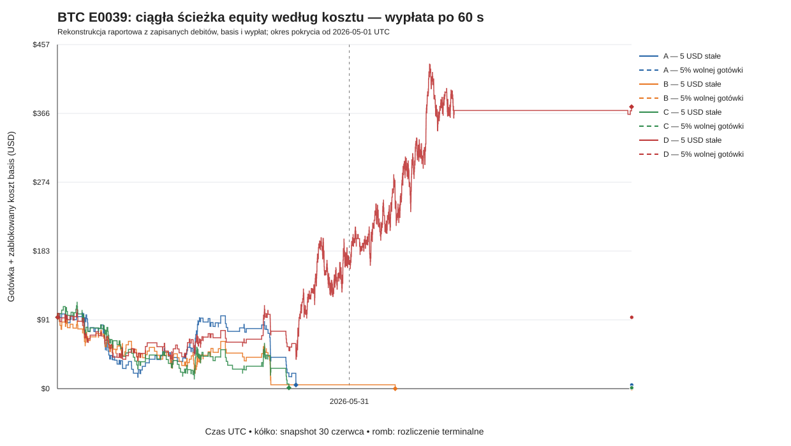

# E0039: wyniki kont i stabilność, 28 października 2026

Raport zamyka część sprawozdawczą E0039 w ramach T0009. Wyniki są warunkowe względem historycznej próbki i dostępnych oficjalnych kalibracji. Nie stanowią wyniku holdoutu ani potwierdzenia przewagi do wdrożenia.

## Krótkie odpowiedzi

Przy stałym zakupie za 5 USD i opóźnieniu wypłaty 60 s z początkowych 100 USD zostało:

| Model | Końcowe equity | Netto PnL | Zwrot | Maks. obsunięcie kosztowe |
|---|---:|---:|---:|---:|
| A | 4,940 USD | -95,060 USD | -95,060% | 96,031 USD / 95,107% |
| B | 0,003 USD | -99,997 USD | -99,997% | 99,997 USD / 99,997% |
| C | 1,136 USD | -98,864 USD | -98,864% | 113,725 USD / 99,011% |
| D | 374,575 USD | +274,575 USD | +274,575% | 88,718 USD / 64,656% |

Pozostałe trzy konfiguracje opóźnienia wypłaty są pokazane niżej; nie wybieram żadnej jako „rzeczywistej”, bo historyczna dostępność wypłat nie została ustalona.

- Przy tej samej kontroli A, B i C prawie wyzerowały konto. D zakończył oba miesiące wzrostem przypisanym do decyzji z maja i czerwca. W niezależnych zakupach po 5 USD zysk każdego modelu był skoncentrowany głównie w czerwcu; B stracił w maju i jego czerwcowy zysk przekroczył łączny wynik netto. Wszystkie kwoty finansowe w raporcie są w USD.
- Kontrola 5% wolnej gotówki wykonała tylko jeden zakup po 5 USD dla każdego modelu. Po stracie i debicie 5,18 USD zostało 94,82 USD gotówki; następne żądanie wyniosło 4,741 USD, więc nie spełniało zamrożonego minimum 5 USD. Pierwsze takie odrzucenie nastąpiło 1 maja 2026 o 00:49 UTC, po jednym wcześniejszym fillu. Potem odrzucono poniżej minimum wszystkie pozostałe 5 147 decyzji, aż do ostatniej decyzji 30 czerwca 2026 o 23:34 UTC. Przy pierwszym odrzuceniu koszt basis był już odblokowany: to limit wywołany rozmiarem 5% i minimum zlecenia, a nie gotówka uwięziona w pozycji.
- Zmiana opóźnienia zmienia nie tylko stan gotówki, lecz także liczbę filli. Dla D wynik terminalny wynosił 374,575 USD przy 60/300/1800 s i 345,558 USD przy 7200 s; przy 7200 s wystąpiło 10 odrzuceń z braku gotówki. Dla A/B/C każde konto skończyło ze stratą, ale liczba filli i końcowe saldo różniły się między scenariuszami.
- Odrzucenia fixed-5 z braku gotówki rozdzieliłem na decyzje z otwartym kosztem basis i decyzje bez otwartego kosztu. Przy 60 s z 1 235/1 407/1 262 odrzuceń A/B/C odpowiednio tylko 0/1/0 nastąpiło przy zablokowanym koszcie; reszta wystąpiła już bez otwartej pozycji. Przy 7200 s tymczasowo zablokowane było 8/27/19/10 odrzuceń A/B/C/D. Pełny podział jest w pliku kont.

## Założenia, pokrycie i księgowość

E0039 obejmuje trzy ciągłe foldy UTC F1/F2/F3 i jedną ścieżkę kapitału przez ich granice. Każdy model miał surową prognozę na 5 604 rynkach z czystej whitelisty. Oficjalna kalibracja była dostępna dla 5 148 rynków; 456 rynków z kwietnia/F1 nie spełniło minimalnej liczby wcześniejszych obserwacji kalibratora.

| Miesiąc UTC / fold | Czyste rynki z surową prognozą na model | Skalibrowane rynki na model | Status ekonomiczny |
|---|---:|---:|---|
| Kwiecień / F1 | 456 | 0 | Minimum kalibracji nieosiągnięte; ekonomicznie nietestowalne według zamrożonej reguły |
| Maj / F2 | 2 315 | 2 315 | Dostępna decyzja i kalibracja |
| Czerwiec / F3 | 2 833 | 2 833 | Dostępna decyzja i kalibracja |
| **Razem** | **5 604** | **5 148** | **456 braków pokrycia nie jest `no_trade`** |

Zachowane 100 USD na granicy kwietnia wynika z braku skalibrowanych decyzji. Nie oznacza zera zysku w przetestowanym miesiącu i nie dowodzi jakości strategii.

Wyniki niezależnych zakupów po 5 USD są odrębnym, nieograniczonym kapitałem diagnostycznym. Nie są wynikami konta samofinansującego się. Konta rozpoczynały ze 100 USD, kupowały tylko po dodatnim EV zgodnie z zamrożoną regułą, używały natywnych asków T-59 i utrzymywały pozycję do oficjalnej wypłaty Gamma. Opłata gotówkowa jest już zawarta w `cash_debit_usd`; w uzgodnieniu nie odejmowałem jej ponownie.

Ponieważ pliki miesięczne nie zawierały zdarzeń pośrednich do wykresu, odtworzyłem **wyłącznie księgę raportową** z zapisanych zaakceptowanych filli, kwot debitów, kwot wypłat i czasów ich dostępności. Zachowałem porządek decyzji i semantykę zwolnienia wypłat przez `release_payouts_available_by`. Nie odtwarzałem sygnałów, kwalifikacji, filli, cen ani opłat. Rekonstrukcja uzgadnia końcową gotówkę, equity, liczbę filli, wypłaty, opłaty, obrót, szczyt zablokowanego kosztu i obsunięcie procentowe z manifestem oraz wszystkie 96 zapisanych miesięcznych snapshotów. Każda przyjęta pozycja ma dokładnie jedno rozliczenie; końcowo nie ma otwartych pozycji, ujemnej gotówki, dopłat ani kredytu.

Equity i obsunięcie kosztowe oznaczają `free_cash + locked_cost_basis`. To nie jest wycena mark-to-market. Procent drawdown liczony jest od wcześniejszego szczytu equity; maksimum kwotowe i maksimum procentowe mogą wystąpić w różnych chwilach. Ich znaczniki czasu są rozdzielone w CSV.

## Wszystkie 32 konta

Każdy wiersz to osobne konto ze startem 100 USD. Nie należy sumować wierszy jako wyniku jednej strategii. „Odrzuc. gotówka” oznacza zamrożone zlecenie, którego pełny debit nie mieścił się w wolnej gotówce. „Odrzuc. < min.” oznacza żądanie poniżej zamrożonego minimum 5 USD bez zaokrąglania w górę.

| Model | Kontrola | Opóźnienie (s) | Equity końcowe | Netto PnL | Zwrot | Maks. drawdown USD / % | Fille | Odrzuc. gotówka | Odrzuc. < min. |
|---|---|---:|---:|---:|---:|---:|---:|---:|---:|
| A | 5 USD stałe | 60 | 4,940 | -95,060 | -95,060% | 96,031 / 95,107% | 189 | 1 235 | 0 |
| A | 5% wolnej gotówki | 60 | 94,820 | -5,180 | -5,180% | 5,180 / 5,180% | 1 | 0 | 5 147 |
| B | 5 USD stałe | 60 | 0,003 | -99,997 | -99,997% | 99,997 / 99,997% | 212 | 1 407 | 0 |
| B | 5% wolnej gotówki | 60 | 94,820 | -5,180 | -5,180% | 5,180 / 5,180% | 1 | 0 | 5 147 |
| C | 5 USD stałe | 60 | 1,136 | -98,864 | -98,864% | 113,725 / 99,011% | 210 | 1 262 | 0 |
| C | 5% wolnej gotówki | 60 | 94,820 | -5,180 | -5,180% | 5,180 / 5,180% | 1 | 0 | 5 147 |
| D | 5 USD stałe | 60 | 374,575 | +274,575 | +274,575% | 88,718 / 64,656% | 1 589 | 0 | 0 |
| D | 5% wolnej gotówki | 60 | 94,820 | -5,180 | -5,180% | 5,180 / 5,180% | 1 | 0 | 5 147 |
| A | 5 USD stałe | 300 | 4,940 | -95,060 | -95,060% | 96,031 / 95,107% | 189 | 1 235 | 0 |
| A | 5% wolnej gotówki | 300 | 94,820 | -5,180 | -5,180% | 5,180 / 5,180% | 1 | 0 | 5 147 |
| B | 5 USD stałe | 300 | 0,003 | -99,997 | -99,997% | 99,997 / 99,997% | 212 | 1 407 | 0 |
| B | 5% wolnej gotówki | 300 | 94,820 | -5,180 | -5,180% | 5,180 / 5,180% | 1 | 0 | 5 147 |
| C | 5 USD stałe | 300 | 1,136 | -98,864 | -98,864% | 113,548 / 99,009% | 210 | 1 262 | 0 |
| C | 5% wolnej gotówki | 300 | 94,820 | -5,180 | -5,180% | 5,180 / 5,180% | 1 | 0 | 5 147 |
| D | 5 USD stałe | 300 | 374,575 | +274,575 | +274,575% | 88,718 / 64,821% | 1 589 | 0 | 0 |
| D | 5% wolnej gotówki | 300 | 94,820 | -5,180 | -5,180% | 5,180 / 5,180% | 1 | 0 | 5 147 |
| A | 5 USD stałe | 1 800 | 4,940 | -95,060 | -95,060% | 96,031 / 95,107% | 189 | 1 235 | 0 |
| A | 5% wolnej gotówki | 1 800 | 94,820 | -5,180 | -5,180% | 5,180 / 5,180% | 1 | 0 | 5 147 |
| B | 5 USD stałe | 1 800 | 4,810 | -95,190 | -95,190% | 95,190 / 95,190% | 213 | 1 406 | 0 |
| B | 5% wolnej gotówki | 1 800 | 94,820 | -5,180 | -5,180% | 5,180 / 5,180% | 1 | 0 | 5 147 |
| C | 5 USD stałe | 1 800 | 2,031 | -97,969 | -97,969% | 112,653 / 98,229% | 208 | 1 264 | 0 |
| C | 5% wolnej gotówki | 1 800 | 94,820 | -5,180 | -5,180% | 5,180 / 5,180% | 1 | 0 | 5 147 |
| D | 5 USD stałe | 1 800 | 374,575 | +274,575 | +274,575% | 88,547 / 65,445% | 1 589 | 0 | 0 |
| D | 5% wolnej gotówki | 1 800 | 94,820 | -5,180 | -5,180% | 5,180 / 5,180% | 1 | 0 | 5 147 |
| A | 5 USD stałe | 7 200 | 4,940 | -95,060 | -95,060% | 95,855 / 95,099% | 189 | 1 235 | 0 |
| A | 5% wolnej gotówki | 7 200 | 94,820 | -5,180 | -5,180% | 5,180 / 5,180% | 1 | 0 | 5 147 |
| B | 5 USD stałe | 7 200 | 0,636 | -99,364 | -99,364% | 99,364 / 99,364% | 189 | 1 430 | 0 |
| B | 5% wolnej gotówki | 7 200 | 94,820 | -5,180 | -5,180% | 5,180 / 5,180% | 1 | 0 | 5 147 |
| C | 5 USD stałe | 7 200 | 1,832 | -98,168 | -98,168% | 112,500 / 98,398% | 151 | 1 321 | 0 |
| C | 5% wolnej gotówki | 7 200 | 94,820 | -5,180 | -5,180% | 5,180 / 5,180% | 1 | 0 | 5 147 |
| D | 5 USD stałe | 7 200 | 345,558 | +245,558 | +245,558% | 88,571 / 65,500% | 1 579 | 10 | 0 |
| D | 5% wolnej gotówki | 7 200 | 94,820 | -5,180 | -5,180% | 5,180 / 5,180% | 1 | 0 | 5 147 |

Maksima kwotowe i procentowe drawdownu są liczone osobno po tej samej ciągłej ścieżce. Szczegółowe szczyty i dołki obu miar znajdują się w CSV.

### Opłaty, obrót i kapitał zablokowany

Wszystkie konta końcowo mają zero nierozliczonych pozycji. Opłaty udziałowe wynoszą zero; debity gotówkowe zawierają opłaty gotówkowe. Poniżej pokazuję fixed-5 dla wszystkich scenariuszy. Wiersz 5% dotyczy każdej z 16 kombinacji modelu i opóźnienia, które mają identyczne przepływy; pełne 32 wiersze pomocnicze są w CSV.

| Model | Kontrola | Opóźnienie (s) | Opłaty gotówkowe | Obrót | Maks. zablokowany koszt | Gotówka końcowa | Nierozliczone |
|---|---|---:|---:|---:|---:|---:|---:|
| A | 5 USD stałe | 60 | 33,283 | 945 | 10 | 4,940 | 0 |
| B | 5 USD stałe | 60 | 37,098 | 1 060 | 10 | 0,003 | 0 |
| C | 5 USD stałe | 60 | 36,683 | 1 050 | 10 | 1,136 | 0 |
| D | 5 USD stałe | 60 | 281,233 | 7 945 | 10 | 374,575 | 0 |
| A | 5 USD stałe | 300 | 33,283 | 945 | 15 | 4,940 | 0 |
| B | 5 USD stałe | 300 | 37,098 | 1 060 | 15 | 0,003 | 0 |
| C | 5 USD stałe | 300 | 36,683 | 1 050 | 15 | 1,136 | 0 |
| D | 5 USD stałe | 300 | 281,233 | 7 945 | 15 | 374,575 | 0 |
| A | 5 USD stałe | 1 800 | 33,283 | 945 | 30 | 4,940 | 0 |
| B | 5 USD stałe | 1 800 | 37,290 | 1 065 | 25 | 4,810 | 0 |
| C | 5 USD stałe | 1 800 | 36,354 | 1 040 | 25 | 2,031 | 0 |
| D | 5 USD stałe | 1 800 | 281,233 | 7 945 | 40 | 374,575 | 0 |
| A | 5 USD stałe | 7 200 | 33,283 | 945 | 45 | 4,940 | 0 |
| B | 5 USD stałe | 7 200 | 33,153 | 945 | 30 | 0,636 | 0 |
| C | 5 USD stałe | 7 200 | 26,547 | 755 | 30 | 1,832 | 0 |
| D | 5 USD stałe | 7 200 | 279,458 | 7 895 | 95 | 345,558 | 0 |
| A/B/C/D | 5% wolnej gotówki | 60/300/1800/7200 | 0,180 | 5 | 5 | 94,820 | 0 |

## Miesiące i ciągłość kapitału

Zysk pozycji niezależnych przypisuję do `market_start_utc`, zgodnie z zapisanym agregatorem diagnostycznym. Dla kont pole `monthly_realized_pnl_usd` przypisuje końcowy PnL do `decision_time_utc`; suma maja i czerwca uzgadnia się z terminalnym PnL. To nie jest miesięczny przepływ gotówki.

| Model | Niezależne $5, maj | Niezależne $5, czerwiec | Konto fixed-5 60 s, maj | Konto fixed-5 60 s, czerwiec |
|---|---:|---:|---:|---:|
| A | +16,339 | +123,606 | -95,060 | 0,000 |
| B | -84,355 | +173,449 | -94,843 | -5,154 |
| C | +49,784 | +168,186 | -98,864 | 0,000 |
| D | +70,512 | +204,063 | +70,512 | +204,063 |

Rzeczywiste debity i wypłaty według scenariusza, przyrost gotówki oraz końcowe snapshoty dla wszystkich 32 kont są w pliku miesięcznym. Dla 60 s główne przepływy były następujące:

| Model, fixed-5 / 60 s | Debit w maju | Dostępna wypłata w maju | Debit w czerwcu | Dostępna wypłata w czerwcu | Gotówka/equity 30 czerwca |
|---|---:|---:|---:|---:|---:|
| A | 978,283 | 883,223 | 0,000 | 0,000 | 4,940 |
| B | 1 091,944 | 997,101 | 5,154 | 0,000 | 0,003 |
| C | 1 086,683 | 987,819 | 0,000 | 0,000 | 1,136 |
| D | 3 289,109 | 3 359,621 | 4 937,123 | 5 141,186 | 374,575 |

Snapshot z końca czerwca jest na `2026-06-30T23:59:59.999999999Z`. Tabela podaje dla kont fixed-5 gotówkę, zablokowany koszt basis i terminalne equity po ostatniej wypłacie. Dla kontroli 5% snapshot czerwca zawsze wynosi 94,820 USD gotówki, zero zablokowanego kosztu i zero pozycji otwartych.

| Model | Opóźnienie (s) | Gotówka 30 czerwca | Zablokowany koszt | Equity 30 czerwca | Otwarte pozycje | Terminalne equity po wszystkich wypłatach |
|---|---:|---:|---:|---:|---:|---:|
| A | 60 | 4,940 | 0 | 4,940 | 0 | 4,940 |
| A | 300 | 4,940 | 0 | 4,940 | 0 | 4,940 |
| A | 1 800 | 4,940 | 0 | 4,940 | 0 | 4,940 |
| A | 7 200 | 4,940 | 0 | 4,940 | 0 | 4,940 |
| B | 60 | 0,003 | 0 | 0,003 | 0 | 0,003 |
| B | 300 | 0,003 | 0 | 0,003 | 0 | 0,003 |
| B | 1 800 | 4,810 | 0 | 4,810 | 0 | 4,810 |
| B | 7 200 | 0,636 | 0 | 0,636 | 0 | 0,636 |
| C | 60 | 1,136 | 0 | 1,136 | 0 | 1,136 |
| C | 300 | 1,136 | 0 | 1,136 | 0 | 1,136 |
| C | 1 800 | 2,031 | 0 | 2,031 | 0 | 2,031 |
| C | 7 200 | 1,832 | 0 | 1,832 | 0 | 1,832 |
| D | 60 | 374,575 | 0 | 374,575 | 0 | 374,575 |
| D | 300 | 374,575 | 0 | 374,575 | 0 | 374,575 |
| D | 1 800 | 364,158 | 5 | 369,158 | 1 | 374,575 |
| D | 7 200 | 335,142 | 5 | 340,142 | 1 | 345,558 |

Ostatnie terminy dostępności wypłat przypisane zamrożonym scenariuszom to 30 czerwca 23:41:52 UTC (60 s), 23:45:52 (300 s), 1 lipca 00:10:52 (1 800 s) i 01:40:52 (7 200 s). Na granicy maja D miał 1 pozycję / 5 USD zablokowanego kosztu przy 300 s, 2 / 10 USD przy 1 800 s i 10 / 50 USD przy 7 200 s. Na granicy czerwca jedna pozycja D pozostawała otwarta przy 1 800 i 7 200 s; została rozliczona po tej granicy. Te nierozliczone pozycje wyjaśniają różnicę między miesięczną atrybucją PnL według czasu decyzji a przepływem gotówki w danym miesiącu. Nie przedstawiam tych założeń jako zmierzonej historycznej dostępności wypłat.

Wykres pokazuje zdarzenia na jednej ciągłej ścieżce equity według kosztu dla wszystkich ośmiu kont przy 60 s. Zaczyna się od pierwszej dostępnej kalibrowanej decyzji w maju; kwietniowe 100 USD nie jest pokazane jako wynik testu. Kółka oznaczają snapshot z 30 czerwca, romby terminalne rozliczenie po ostatniej wypłacie.

## Niezależne zakupy i stabilność

Poniższe wyniki dotyczą niezależnych zakupów fixed-5 na tych samych 5 148 dostępnych, skalibrowanych rynkach. Znany `no_trade` pozostaje zerem tylko wtedy, gdy predykcja i decyzja były dostępne. Brak kalibracji w kwietniu pozostaje brakiem pokrycia.

| Model | Maj | Czerwiec | Suma netto | Czerwiec / suma netto | Najlepszy dzień UTC | Najgorszy dzień UTC | 5 najlepszych dni / suma dodatnich dziennych PnL |
|---|---:|---:|---:|---:|---|---|---:|
| A | +16,339 | +123,606 | +139,945 | 88,3% | 2026-06-09: +58,290 | 2026-05-29: -63,925 | 245,502 / 464,010 = 52,9% |
| B | -84,355 | +173,449 | +89,094 | 194,7% | 2026-06-09: +80,404 | 2026-05-29: -89,290 | 319,582 / 485,380 = 65,8% |
| C | +49,784 | +168,186 | +217,970 | 77,2% | 2026-06-09: +69,619 | 2026-06-10: -49,446 | 285,332 / 524,698 = 54,4% |
| D | +70,512 | +204,063 | +274,575 | 74,3% | 2026-06-09: +70,446 | 2026-05-29: -60,858 | 292,078 / 538,418 = 54,2% |

Udział czerwca ma w mianowniku cały łączny netto PnL maja i czerwca, dlatego dla B przekracza 100%: maj był stratny. Udział pięciu najlepszych dni ma inny mianownik: sumę wyłącznie dodatnich dziennych PnL. To miara koncentracji, nie udziału w zysku netto. Dodatni wynik kwotowy nie jest przewagą potwierdzoną statystycznie; nie dodawałem bootstrapu ani testów istotności.

Sparowane różnice używają tych samych rynków i kierunku podanego w etykiecie. Miesięczne liczności wynoszą 2 315 w maju i 2 833 w czerwcu.

| Różnica | Maj | Czerwiec | Łącznie, 5 148 wspólnych rynków |
|---|---:|---:|---:|
| B−A | -100,694 | +49,842 | -50,851 |
| C−A | +33,445 | +44,580 | +78,025 |
| D−B | +154,867 | +30,614 | +185,481 |
| D−C | +20,728 | +35,877 | +56,605 |

## Zakres wniosków i kolejny krok

Uzyskaliśmy odtworzone, uzgodnione wyniki finansowe dla 32 samofinansujących się kont, niezależną diagnostykę fixed-5 na wspólnej skalibrowanej próbce oraz jawny miesięczny przepływ kapitału. Wyniki kont zależą od modelu i dostępności kapitału; zysk niezależnych zakupów nie zastępuje wyniku konta. Wynik dodatni D dotyczy wyłącznie tej retrospektywnej próbki development.

Nadal nie wiemy, jakie byłyby faktyczne historyczne czasy dostępności wypłat ani czy istniała historyczna gotowość predykcji przed T-59. Pokrycie źródeł T0009 nadal jest niepełne, bramka parytetu E0037 pozostaje `FAILED`, a historyczna gotowość pozostaje `UNKNOWN`. Rodzina A/B/C/D była wcześniej eksponowana; wynik nie stanowi niezależnego potwierdzenia. Holdout `[2026-07-01, 2026-10-07)` UTC nie został użyty, a raport nie upoważnia do jego oceny, pilota, live/shadow ani zleceń. T0009 pozostaje `BLOCKED`; T0010 pozostaje `DEFERRED`.

**Proponowany następny krok, poza zakresem tego pakietu:** osobno uzgodnić source/readiness gate dla T0009 na podstawie już zarejestrowanych braków pokrycia i wiarygodnego źródła timestampów gotowości predykcji. Nie wznawiać ekonomiki ani nie otwierać holdoutu, dopóki ten gate nie zostanie spełniony i nie będzie nowej, jawnej autoryzacji zakresu.

## Pochodzenie i artefakty

- Eksperyment: `E0039`; zadanie: `T0009`.
- Pełna tożsamość runu: `508858c48b11b9252e4ec3aa0e7814579f2fe770ef8840e32fd86dca6c6bd8d0`.
- Protokół [E0039 v7](../../configs/research/btc_chronology_reconstruction_20261027_v7.json), SHA-256: `9c6aca98034ca010cda16e326053ce83e2c78dbab0120445be8ec1180392baf6`.
- SHA-256 whitelisty ID: `e2946aa8e45c2ed050347e18756408a0175fa0eb9859a120f8df7c173051edda`.
- Hashe zamrożonych projekcji źródeł: `economics_gamma` `2376742f69af58ae09abd2f97a69a790e8a4478b534e89c489650bd2e03e79f1`; `official_gamma` `8a57353f8ab2fa192dda31d5848c08d8a942ac2cfecba42c3fd02c3d6b97cc88`; `t59_asks` `8cd8b338718a6c2aea41624015723ae6f7246232a114db40643d51052e5676f7`; `t60_books` `18bcea350e8857c42d236fe44d9753c98fd8c1bf9ab7f4d1e1d6060eca5f4165`.
- Hashe wyjść ekonomii sprawdzono względem manifestu runu. Pełny wykaz wejść i wyjść oraz hashe plików pochodnych zapisano w [JSON pakietu](btc_e0039_accounts_and_stability_20261028.json). Manifest E0039 wykazuje 0 wierszy confirmation i 0 wierszy holdoutu.
- Dane: [tabela 32 kont](btc_e0039_accounts_20261028.csv), [przepływy i opłaty](btc_e0039_account_flows_20261028.csv), [snapshoty i miesięczne przepływy](btc_e0039_monthly_20261028.csv), [porównania stabilności](btc_e0039_stability_20261028.csv), [wykres](btc_e0039_accounts_equity_60s_20261028.svg).
- Generator raportu księgowego: [report_btc_e0039_accounts_20261028.py](../../scripts/report_btc_e0039_accounts_20261028.py). Zawiera stałe ścieżki; nie uruchamia runnera badawczego ani logiki decyzji.
