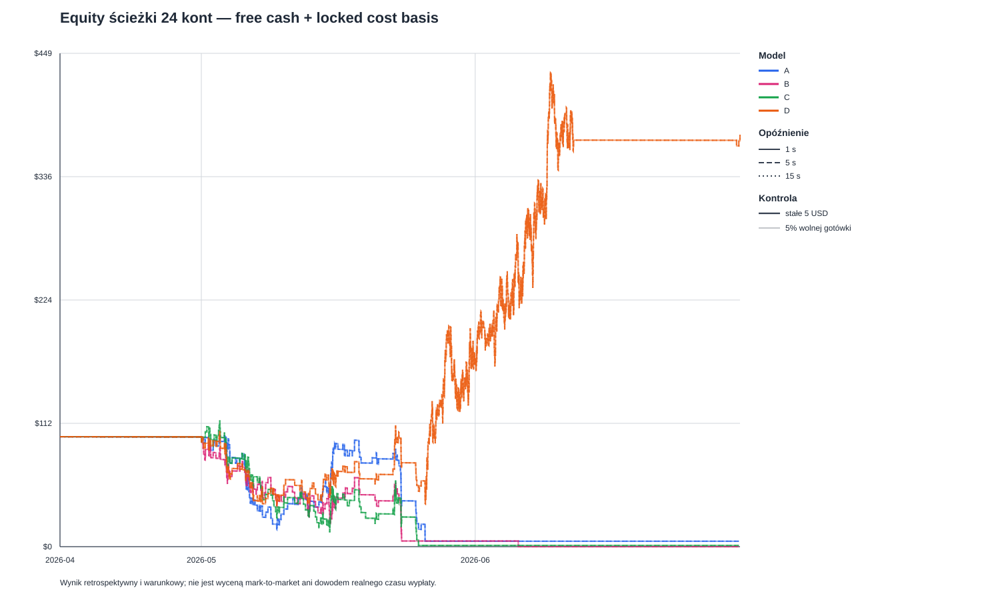

# E0039: rozliczenie kapitału przy opóźnieniach 1/5/15 s

## Odpowiedź bezpośrednia

Każde konto zaczęło od 100 USD. Poniżej pokazano wszystkie trzy uzgodnione opóźnienia dla stałej stawki 5 USD. Porównanie z historycznym E0039 przy 60 s jest wyłącznie punktem odniesienia.

| Model | Delay | Equity końcowe | Netto PnL | Drawdown kosztowy USD / % | Fille | Odrzuc. cash | Max zablok. koszt | Max pozycji równocześnie | Δ equity vs stare 60 s | Δ drawdown USD vs stare 60 s | Δ fille vs stare 60 s |
|---|---:|---:|---:|---:|---:|---:|---:|---:|---:|---:|---:|
| A | 1 s | 4.940 | -95.060 | 96.031 / 95.107% | 189 | 1235 | 10.000 | 2 | 0.000 | -0.000 | 0 |
| A | 5 s | 4.940 | -95.060 | 96.031 / 95.107% | 189 | 1235 | 10.000 | 2 | 0.000 | -0.000 | 0 |
| A | 15 s | 4.940 | -95.060 | 96.031 / 95.107% | 189 | 1235 | 10.000 | 2 | 0.000 | -0.000 | 0 |
| B | 1 s | 0.003 | -99.997 | 99.997 / 99.997% | 212 | 1407 | 10.000 | 2 | 0.000 | -0.000 | 0 |
| B | 5 s | 0.003 | -99.997 | 99.997 / 99.997% | 212 | 1407 | 10.000 | 2 | 0.000 | -0.000 | 0 |
| B | 15 s | 0.003 | -99.997 | 99.997 / 99.997% | 212 | 1407 | 10.000 | 2 | 0.000 | -0.000 | 0 |
| C | 1 s | 1.136 | -98.864 | 113.725 / 99.011% | 210 | 1262 | 10.000 | 2 | 0.000 | 0.000 | 0 |
| C | 5 s | 1.136 | -98.864 | 113.725 / 99.011% | 210 | 1262 | 10.000 | 2 | 0.000 | 0.000 | 0 |
| C | 15 s | 1.136 | -98.864 | 113.725 / 99.011% | 210 | 1262 | 10.000 | 2 | 0.000 | 0.000 | 0 |
| D | 1 s | 374.575 | 274.575 | 88.718 / 64.656% | 1589 | 0 | 10.000 | 2 | 0.000 | 0.000 | 0 |
| D | 5 s | 374.575 | 274.575 | 88.718 / 64.656% | 1589 | 0 | 10.000 | 2 | 0.000 | 0.000 | 0 |
| D | 15 s | 374.575 | 274.575 | 88.718 / 64.656% | 1589 | 0 | 10.000 | 2 | 0.000 | 0.000 | 0 |

Kontrola 5% wolnej gotówki nadal podlega minimum D0019. Kwota jest liczona z wolnej gotówki w T−60 i nie jest podnoszona do minimum. Szczegóły filli, odrzuceń i końcowego salda są w głównej tabeli 24 kont.

| Model | Delay | Equity końcowe | Fille | Odrzuc. poniżej 5 USD | Pierwsza stawka poniżej minimum |
|---|---:|---:|---:|---:|---|
| A | 1 s | 94.820 | 1 | 5147 | 2026-05-01T00:49:00+00:00 |
| A | 5 s | 94.820 | 1 | 5147 | 2026-05-01T00:49:00+00:00 |
| A | 15 s | 94.820 | 1 | 5147 | 2026-05-01T00:49:00+00:00 |
| B | 1 s | 94.820 | 1 | 5147 | 2026-05-01T00:49:00+00:00 |
| B | 5 s | 94.820 | 1 | 5147 | 2026-05-01T00:49:00+00:00 |
| B | 15 s | 94.820 | 1 | 5147 | 2026-05-01T00:49:00+00:00 |
| C | 1 s | 94.820 | 1 | 5147 | 2026-05-01T00:49:00+00:00 |
| C | 5 s | 94.820 | 1 | 5147 | 2026-05-01T00:49:00+00:00 |
| C | 15 s | 94.820 | 1 | 5147 | 2026-05-01T00:49:00+00:00 |
| D | 1 s | 94.820 | 1 | 5147 | 2026-05-01T00:49:00+00:00 |
| D | 5 s | 94.820 | 1 | 5147 | 2026-05-01T00:49:00+00:00 |
| D | 15 s | 94.820 | 1 | 5147 | 2026-05-01T00:49:00+00:00 |

## Zakres i księgowanie

Wykonano 24 ciągłe konta: A/B/C/D × stałe 5 USD/5% wolnej gotówki × 1/5/15 s. Pokrycie nie zmieniło się: 5 604 czyste rynki z surową prognozą na model, 5 148 z zapisaną oficjalną kalibracją, 456 kwietniowych bez minimum kalibracji. Te 456 pozostają brakiem ekonomicznego pokrycia, a nie zerowym PnL.

Wypłata jest symulowana jako `max(market_start_utc + 5 minutes, Gamma resolved_at_utc) + delay_seconds`; Gamma jest tylko zapisanym punktem odniesienia, nie pomiarem faktycznego księgowania środków. Pozycje są trzymane do oficjalnego rozstrzygnięcia. Parametr nie przesuwa T−60/T−59 ani pipeline’u prognoz.

Korekta chronologii jest osobnym elementem protokołu: najpierw w T−60 zapisuje się wolną gotówkę, stawkę, stronę i EV. Przy księgowaniu T−59 przed kontrolą debitu zwalniane są wypłaty dostępne do tego timestampu włącznie. Wypłata późniejsza nie finansuje bieżącego zakupu. Stary E0039 zwalniał wypłaty w T−60; różnice wobec historycznego 60 s mogą zatem wynikać zarówno z nowej listy opóźnień, jak i z poprawionej obsługi zdarzeń T−59.

Decyzje nadal używają dodatniego EV w T−60, maksymalnego EV z remisem UP, pełnego fillu w natywnej drabince T−59, dotychczasowych opłat i minimum 5 USD bez podnoszenia nominału. Wszystkie pozycje przechodzą przez granice foldów i miesięcy; po ostatniej decyzji wypłaty rozliczono terminalnie. Equity to wolna gotówka plus zablokowany koszt basis, nie mark-to-market.

## Wszystkie 24 konta

| Model | Kontrola | Delay | Equity | Netto PnL | Drawdown USD / % | Fille | Odrzuc. cash | Odrzuc. < min | Max zablok. koszt | Max równoczesnych pozycji |
|---|---|---:|---:|---:|---:|---:|---:|---:|---:|---:|
| A | stałe 5 USD | 1 s | 4.940 | -95.060 | 96.031 / 95.107% | 189 | 1235 | 0 | 10.000 | 2 |
| A | 5% wolnej gotówki | 1 s | 94.820 | -5.180 | 5.180 / 5.180% | 1 | 0 | 5147 | 5.000 | 1 |
| A | stałe 5 USD | 5 s | 4.940 | -95.060 | 96.031 / 95.107% | 189 | 1235 | 0 | 10.000 | 2 |
| A | 5% wolnej gotówki | 5 s | 94.820 | -5.180 | 5.180 / 5.180% | 1 | 0 | 5147 | 5.000 | 1 |
| A | stałe 5 USD | 15 s | 4.940 | -95.060 | 96.031 / 95.107% | 189 | 1235 | 0 | 10.000 | 2 |
| A | 5% wolnej gotówki | 15 s | 94.820 | -5.180 | 5.180 / 5.180% | 1 | 0 | 5147 | 5.000 | 1 |
| B | stałe 5 USD | 1 s | 0.003 | -99.997 | 99.997 / 99.997% | 212 | 1407 | 0 | 10.000 | 2 |
| B | 5% wolnej gotówki | 1 s | 94.820 | -5.180 | 5.180 / 5.180% | 1 | 0 | 5147 | 5.000 | 1 |
| B | stałe 5 USD | 5 s | 0.003 | -99.997 | 99.997 / 99.997% | 212 | 1407 | 0 | 10.000 | 2 |
| B | 5% wolnej gotówki | 5 s | 94.820 | -5.180 | 5.180 / 5.180% | 1 | 0 | 5147 | 5.000 | 1 |
| B | stałe 5 USD | 15 s | 0.003 | -99.997 | 99.997 / 99.997% | 212 | 1407 | 0 | 10.000 | 2 |
| B | 5% wolnej gotówki | 15 s | 94.820 | -5.180 | 5.180 / 5.180% | 1 | 0 | 5147 | 5.000 | 1 |
| C | stałe 5 USD | 1 s | 1.136 | -98.864 | 113.725 / 99.011% | 210 | 1262 | 0 | 10.000 | 2 |
| C | 5% wolnej gotówki | 1 s | 94.820 | -5.180 | 5.180 / 5.180% | 1 | 0 | 5147 | 5.000 | 1 |
| C | stałe 5 USD | 5 s | 1.136 | -98.864 | 113.725 / 99.011% | 210 | 1262 | 0 | 10.000 | 2 |
| C | 5% wolnej gotówki | 5 s | 94.820 | -5.180 | 5.180 / 5.180% | 1 | 0 | 5147 | 5.000 | 1 |
| C | stałe 5 USD | 15 s | 1.136 | -98.864 | 113.725 / 99.011% | 210 | 1262 | 0 | 10.000 | 2 |
| C | 5% wolnej gotówki | 15 s | 94.820 | -5.180 | 5.180 / 5.180% | 1 | 0 | 5147 | 5.000 | 1 |
| D | stałe 5 USD | 1 s | 374.575 | 274.575 | 88.718 / 64.656% | 1589 | 0 | 0 | 10.000 | 2 |
| D | 5% wolnej gotówki | 1 s | 94.820 | -5.180 | 5.180 / 5.180% | 1 | 0 | 5147 | 5.000 | 1 |
| D | stałe 5 USD | 5 s | 374.575 | 274.575 | 88.718 / 64.656% | 1589 | 0 | 0 | 10.000 | 2 |
| D | 5% wolnej gotówki | 5 s | 94.820 | -5.180 | 5.180 / 5.180% | 1 | 0 | 5147 | 5.000 | 1 |
| D | stałe 5 USD | 15 s | 374.575 | 274.575 | 88.718 / 64.656% | 1589 | 0 | 0 | 10.000 | 2 |
| D | 5% wolnej gotówki | 15 s | 94.820 | -5.180 | 5.180 / 5.180% | 1 | 0 | 5147 | 5.000 | 1 |

## Wyniki miesięczne i ścieżki kont

`btc_e0039_settlement_1_5_15s_monthly_snapshots_20261028.csv` zawiera snapshoty końca kwietnia, maja i czerwca dla wszystkich scenariuszy oraz terminalne snapshoty po ostatnich wypłatach. `btc_e0039_settlement_1_5_15s_monthly_flows_20261028.csv` przypisuje PnL do miesiąca decyzji T−60, debity do miesiąca zakupu T−59, a wypłaty do miesiąca faktycznego zdarzenia księgowego.

## Kontrola parytetu i uzgodnienie terminalne

Niezależne zakupy po 5 USD odtworzyły decyzje, fill status, kwoty, fee i PnL w zapisanym E0039 wiersz po wierszu; te same transakcje i sumy wyszły dla 1/5/15 s.

| Model | Fille niezależne | Netto PnL USD | Row-level różnice |
|---|---:|---:|---:|
| A | 1424 | 139.945271869044 | 0 |
| B | 1619 | 89.093840071001 | 0 |
| C | 1472 | 217.969791477041 | 0 |
| D | 1589 | 274.574785193205 | 0 |

Każde z 24 kont uzgadnia końcową gotówkę z 100 USD − debity (wraz z fee) + wypłaty. Liczba zaakceptowanych transakcji równa się liczbie jednorazowych rozliczeń; nierozliczone pozycje wynoszą zero. Brak dopłat i ujemnej gotówki.

## Historyczne porównanie i ograniczenia

Historyczny wariant 60 s z raportu E0039 pozostaje niezmieniony i jest użyty wyłącznie jako punkt odniesienia. Zakres `Δ equity` i `Δ fille` wobec niego znajduje się w pierwszej tabeli. Nie wybieram najlepszego PnL jako rzeczywistego opóźnienia. 1/5/15 s to uzgodnione założenia symulacji, a nie zmierzone opóźnienia Polymarket.

Wynik jest retrospektywny, warunkowy względem już wcześniej eksponowanej rodziny A/B/C/D i dostępnych prognoz. Nie zamyka T0009, nie zmienia historycznego `FAILED` dla E0037, nie ustala historycznej gotowości predykcji ani rzeczywistego czasu wypłaty. Nie użyto holdoutu, confirmation rows, źródeł sieciowych, live/shadow ani zleceń.

## Pochodzenie, kod i walidacja

- E0039 run: `508858c48b11b9252e4ec3aa0e7814579f2fe770ef8840e32fd86dca6c6bd8d0`; źródłowy v7 SHA-256 `9c6aca98034ca010cda16e326053ce83e2c78dbab0120445be8ec1180392baf6`.
- E0040 protocol SHA-256: `2f069cac9f58997860ed956c1b41850abc740c2c52e17d28688a5599292649ce`; replay SHA-256: `27634bcbcc1068ae0b4907d4ffa3e2deddb312a17089e16aeb2c4963a3b99522`.
- Kontrole wejść/hashów: 26.
- Czas replayu: 32.293 s; decyzji kont: 123552.
- Testy mechaniki E0040 i pełny zestaw repozytorium są zapisane w `EXPERIMENTS.md` po wykonaniu.
