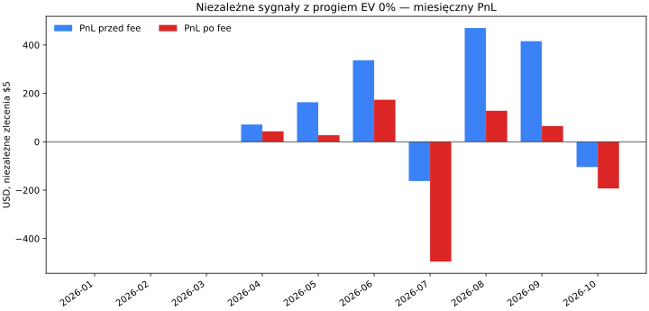
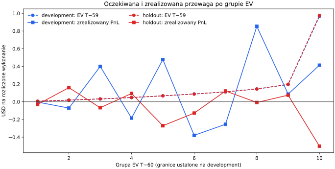
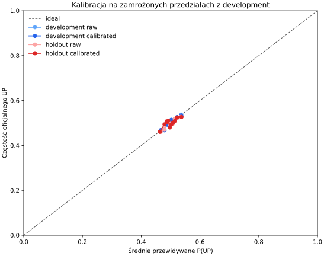
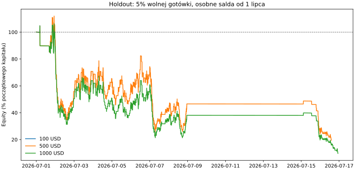

> Zastąpiony korektą z 2026-10-12: wyceny wykonania niezależnych sygnałów błędnie używały snapshotu T−60. Aktualne wartości filli, PnL, bootstrap i wykresów są w [raporcie po korekcie](btc_preopen_signal_diagnostic_correction_20261012.md). Diagnostyka portfeli 5% pozostaje bez zmian, bo korzystała z T−59.

# Diagnostyka przewagi BTC 5m — 2026-10-12

> Historycznie oglądany holdout (2026-07-01–2026-10-06); raport jest diagnostyką, nie niezależnym testem potwierdzającym.
> Niezależne sygnały $5 nie są portfelem $100; ich łączny PnL nie jest wynikiem osiągalnym z takim depozytem.

## Werdykt

Na całym holdoucie model ma słabe rozróżnianie (AUC 52.20%); log loss 0.69247 wobec 0.69315 i Brier 0.24966 wobec 0.25000 dla baseline’u 0.5, slope/intercept 0.790/-0.001. Sygnały zero-hurdle: Development: $571.26 przed fee, $243.46 po fee; holdout: $618.58 / $-495.43; łącznie: $1,189.85 / $-251.97 na odpowiednich rozliczonych fillach. W portfelu 5% wolnej gotówki zawartość minimum ogranicza aktywność: fill’e dla kapitałów $100/$500/$1000 = 2/582/603, a pominięcia przez minimum = 23105/20869/20773. Szczegóły miesięczne i rozkład wykonania pokazują, czy poza minimum brakowało również dodatnich sygnałów.

## Zamrożony zakres i dane

Development obejmuje predykcje od 2026-01-01T00:00:00+00:00 do cutoffu 2026-07-01T00:00:00+00:00; holdout obejmuje starty rynków od tej daty do 2026-10-07T00:00:00+00:00 (exclusive). Progi EV zachowano z konfiguracji eksperymentu: 0%, 0.25%, 0.5%, 1%, 2%. Aktywny challenger wybrany na development: `free_cash_5pct_ev_0.0000pct` przy hurdle 0%; oficjalny selektor no-trade pozostał bez zmian (`no_trade`).

Użyto 80,352 gotowych predykcji, 79,680 potwierdzonych rynków, 79,666 oficjalnych wyników oraz 50,184/50,184 snapshotów T−60/T−59. Księgi do ekonomiki zaczynają się 2026-04-15T17:05:00+00:00; brak wcześniejszych snapshotów jest raportowany jako przyczyna, nie jako wyceniony sygnał.

Nie trenowano modelu, nie robiono refitu ani replayu archiwum księgi. Nie zmieniono konfiguracji live. Opłaty, minimum USDC, FAK i częściowe wypełnienia pochodzą z zaakceptowanego fee-correction.

## Niezależne zlecenia $5

Każda decyzja wybiera stronę wyłącznie z wyceny T−60. Wykonanie testuje tę samą stronę na T−59. Zlecenia nie współdzielą salda. Wyniki PnL liczą wyłącznie wykonania z oficjalnym rozliczeniem; fill bez etykiety pozostaje policzony jako fill, ale nie dostaje PnL równemu zero.

### Łącznie

| Okres | EV min. | Rynki | Predykcje | Decyzje wycenialne | Sygnały | Fille | Rozliczone fille | Obrót na wspólnej próbie | Fee eq. | PnL brutto | PnL netto | Netto/obrót | Wygrane–przegrane | Śr. cena | Pełna księga / proxy / partial |
|---|---:|---:|---:|---:|---:|---:|---:|---:|---:|---:|---:|---:|---:|---:|---:|
| development | 0% | 47,489 | 52,128 | 9,329 | 1,818 | 1,818 | 1,818 | $9,090.00 | $325.65 | $571.26 | $243.46 | 2.68% | 946–872 | $0.487 | 1,818 / 0 / 0 |
| development | 0.25% | 47,489 | 52,128 | 9,329 | 1,636 | 1,636 | 1,636 | $8,180.00 | $293.63 | $539.38 | $244.11 | 2.98% | 852–784 | $0.486 | 1,636 / 0 / 0 |
| development | 0.5% | 47,489 | 52,128 | 9,329 | 1,459 | 1,459 | 1,459 | $7,295.00 | $262.55 | $515.07 | $250.88 | 3.44% | 761–698 | $0.484 | 1,459 / 0 / 0 |
| development | 1% | 47,489 | 52,128 | 9,329 | 1,146 | 1,146 | 1,146 | $5,730.00 | $207.50 | $455.93 | $247.65 | 4.32% | 598–548 | $0.480 | 1,146 / 0 / 0 |
| development | 2% | 47,489 | 52,128 | 9,329 | 716 | 716 | 716 | $3,580.00 | $131.75 | $318.62 | $185.53 | 5.18% | 370–346 | $0.470 | 716 / 0 / 0 |
| holdout | 0% | 28,222 | 28,224 | 23,113 | 6,248 | 6,248 | 6,248 | $31,240.00 | $1,114.01 | $618.58 | $-495.43 | -1.59% | 3,132–3,116 | $0.486 | 6,248 / 0 / 0 |
| holdout | 0.25% | 28,222 | 28,224 | 23,113 | 5,705 | 5,705 | 5,705 | $28,525.00 | $1,020.03 | $530.46 | $-489.57 | -1.72% | 2,849–2,856 | $0.484 | 5,705 / 0 / 0 |
| holdout | 0.5% | 28,222 | 28,224 | 23,113 | 5,176 | 5,176 | 5,176 | $25,880.00 | $928.17 | $352.50 | $-575.67 | -2.22% | 2,565–2,611 | $0.482 | 5,176 / 0 / 0 |
| holdout | 1% | 28,222 | 28,224 | 23,113 | 4,272 | 4,272 | 4,272 | $21,360.00 | $770.85 | $180.86 | $-590.00 | -2.76% | 2,094–2,178 | $0.478 | 4,272 / 0 / 0 |
| holdout | 2% | 28,222 | 28,224 | 23,113 | 2,872 | 2,872 | 2,872 | $14,360.00 | $527.55 | $203.27 | $-324.28 | -2.26% | 1,392–1,480 | $0.467 | 2,872 / 0 / 0 |
| combined | 0% | 75,711 | 80,352 | 32,442 | 8,066 | 8,066 | 8,066 | $40,330.00 | $1,439.66 | $1,189.85 | $-251.97 | -0.62% | 4,078–3,988 | $0.486 | 8,066 / 0 / 0 |
| combined | 0.25% | 75,711 | 80,352 | 32,442 | 7,341 | 7,341 | 7,341 | $36,705.00 | $1,313.66 | $1,069.83 | $-245.46 | -0.67% | 3,701–3,640 | $0.484 | 7,341 / 0 / 0 |
| combined | 0.5% | 75,711 | 80,352 | 32,442 | 6,635 | 6,635 | 6,635 | $33,175.00 | $1,190.72 | $867.57 | $-324.79 | -0.98% | 3,326–3,309 | $0.483 | 6,635 / 0 / 0 |
| combined | 1% | 75,711 | 80,352 | 32,442 | 5,418 | 5,418 | 5,418 | $27,090.00 | $978.36 | $636.79 | $-342.35 | -1.26% | 2,692–2,726 | $0.479 | 5,418 / 0 / 0 |
| combined | 2% | 75,711 | 80,352 | 32,442 | 3,588 | 3,588 | 3,588 | $17,940.00 | $659.30 | $521.89 | $-138.76 | -0.77% | 1,762–1,826 | $0.468 | 3,588 / 0 / 0 |

PnL brutto i netto są liczone na tych samych rozliczonych fillach. Fee eq. pokazuje estymowaną opłatę w USD przy wejściu. Dla V1 fee pobierane w udziałach zmienia zrealizowany payout tylko przy wygranej; dlatego osobny `realized fee effect` uzgadnia brutto z netto, a sama kwota fee eq. nie jest mechanicznie odejmowana od każdej przegranej.

### Miesięcznie — wszystkie progi EV

| Miesiąc UTC | EV min. | Rynki | Predykcje | Decyzje wycenialne | Sygnały | Fille | Rozliczone | Obrót | Fee eq. | PnL brutto | PnL netto | Netto/obrót |
|---|---:|---:|---:|---:|---:|---:|---:|---:|---:|---:|---:|---:|
| 2026-01 | 0% | 7,475 | 8,928 | 0 | 0 | 0 | 0 | $0.00 | $0.00 | $0.00 | $0.00 | n/a |
| 2026-01 | 0.25% | 7,475 | 8,928 | 0 | 0 | 0 | 0 | $0.00 | $0.00 | $0.00 | $0.00 | n/a |
| 2026-01 | 0.5% | 7,475 | 8,928 | 0 | 0 | 0 | 0 | $0.00 | $0.00 | $0.00 | $0.00 | n/a |
| 2026-01 | 1% | 7,475 | 8,928 | 0 | 0 | 0 | 0 | $0.00 | $0.00 | $0.00 | $0.00 | n/a |
| 2026-01 | 2% | 7,475 | 8,928 | 0 | 0 | 0 | 0 | $0.00 | $0.00 | $0.00 | $0.00 | n/a |
| 2026-02 | 0% | 4,889 | 8,064 | 0 | 0 | 0 | 0 | $0.00 | $0.00 | $0.00 | $0.00 | n/a |
| 2026-02 | 0.25% | 4,889 | 8,064 | 0 | 0 | 0 | 0 | $0.00 | $0.00 | $0.00 | $0.00 | n/a |
| 2026-02 | 0.5% | 4,889 | 8,064 | 0 | 0 | 0 | 0 | $0.00 | $0.00 | $0.00 | $0.00 | n/a |
| 2026-02 | 1% | 4,889 | 8,064 | 0 | 0 | 0 | 0 | $0.00 | $0.00 | $0.00 | $0.00 | n/a |
| 2026-02 | 2% | 4,889 | 8,064 | 0 | 0 | 0 | 0 | $0.00 | $0.00 | $0.00 | $0.00 | n/a |
| 2026-03 | 0% | 8,928 | 8,928 | 0 | 0 | 0 | 0 | $0.00 | $0.00 | $0.00 | $0.00 | n/a |
| 2026-03 | 0.25% | 8,928 | 8,928 | 0 | 0 | 0 | 0 | $0.00 | $0.00 | $0.00 | $0.00 | n/a |
| 2026-03 | 0.5% | 8,928 | 8,928 | 0 | 0 | 0 | 0 | $0.00 | $0.00 | $0.00 | $0.00 | n/a |
| 2026-03 | 1% | 8,928 | 8,928 | 0 | 0 | 0 | 0 | $0.00 | $0.00 | $0.00 | $0.00 | n/a |
| 2026-03 | 2% | 8,928 | 8,928 | 0 | 0 | 0 | 0 | $0.00 | $0.00 | $0.00 | $0.00 | n/a |
| 2026-04 | 0% | 8,636 | 8,640 | 1,667 | 145 | 145 | 145 | $725.00 | $26.18 | $71.29 | $42.95 | 5.92% |
| 2026-04 | 0.25% | 8,636 | 8,640 | 1,667 | 130 | 130 | 130 | $650.00 | $23.50 | $56.68 | $31.55 | 4.85% |
| 2026-04 | 0.5% | 8,636 | 8,640 | 1,667 | 109 | 109 | 109 | $545.00 | $19.70 | $41.67 | $20.33 | 3.73% |
| 2026-04 | 1% | 8,636 | 8,640 | 1,667 | 66 | 66 | 66 | $330.00 | $11.99 | $17.78 | $5.01 | 1.52% |
| 2026-04 | 2% | 8,636 | 8,640 | 1,667 | 35 | 35 | 35 | $175.00 | $6.40 | $42.77 | $35.03 | 20.02% |
| 2026-05 | 0% | 8,927 | 8,928 | 4,518 | 748 | 748 | 748 | $3,740.00 | $136.36 | $163.28 | $26.92 | 0.72% |
| 2026-05 | 0.25% | 8,927 | 8,928 | 4,518 | 661 | 661 | 661 | $3,305.00 | $120.97 | $125.02 | $4.05 | 0.12% |
| 2026-05 | 0.5% | 8,927 | 8,928 | 4,518 | 589 | 589 | 589 | $2,945.00 | $108.27 | $132.66 | $24.39 | 0.83% |
| 2026-05 | 1% | 8,927 | 8,928 | 4,518 | 463 | 463 | 463 | $2,315.00 | $85.97 | $150.52 | $64.55 | 2.79% |
| 2026-05 | 2% | 8,927 | 8,928 | 4,518 | 300 | 300 | 300 | $1,500.00 | $57.09 | $140.44 | $83.34 | 5.56% |
| 2026-06 | 0% | 8,634 | 8,640 | 3,144 | 925 | 925 | 925 | $4,625.00 | $163.10 | $336.70 | $173.60 | 3.75% |
| 2026-06 | 0.25% | 8,634 | 8,640 | 3,144 | 845 | 845 | 845 | $4,225.00 | $149.17 | $357.67 | $208.50 | 4.94% |
| 2026-06 | 0.5% | 8,634 | 8,640 | 3,144 | 761 | 761 | 761 | $3,805.00 | $134.57 | $340.74 | $206.17 | 5.42% |
| 2026-06 | 1% | 8,634 | 8,640 | 3,144 | 617 | 617 | 617 | $3,085.00 | $109.53 | $287.63 | $178.10 | 5.77% |
| 2026-06 | 2% | 8,634 | 8,640 | 3,144 | 381 | 381 | 381 | $1,905.00 | $68.26 | $135.41 | $67.15 | 3.53% |
| 2026-07 | 0% | 8,927 | 8,928 | 6,453 | 1,861 | 1,861 | 1,861 | $9,305.00 | $332.82 | $-162.51 | $-495.34 | -5.32% |
| 2026-07 | 0.25% | 8,927 | 8,928 | 6,453 | 1,697 | 1,697 | 1,697 | $8,485.00 | $304.32 | $-208.71 | $-513.03 | -6.05% |
| 2026-07 | 0.5% | 8,927 | 8,928 | 6,453 | 1,541 | 1,541 | 1,541 | $7,705.00 | $277.19 | $-323.70 | $-600.89 | -7.80% |
| 2026-07 | 1% | 8,927 | 8,928 | 6,453 | 1,287 | 1,287 | 1,287 | $6,435.00 | $232.88 | $-419.68 | $-652.56 | -10.14% |
| 2026-07 | 2% | 8,927 | 8,928 | 6,453 | 885 | 885 | 885 | $4,425.00 | $162.86 | $-334.65 | $-497.51 | -11.24% |
| 2026-08 | 0% | 8,928 | 8,928 | 6,370 | 1,894 | 1,894 | 1,894 | $9,470.00 | $341.94 | $470.06 | $128.12 | 1.35% |
| 2026-08 | 0.25% | 8,928 | 8,928 | 6,370 | 1,745 | 1,745 | 1,745 | $8,725.00 | $316.11 | $303.28 | $-12.83 | -0.15% |
| 2026-08 | 0.5% | 8,928 | 8,928 | 6,370 | 1,592 | 1,592 | 1,592 | $7,960.00 | $289.55 | $339.74 | $50.19 | 0.63% |
| 2026-08 | 1% | 8,928 | 8,928 | 6,370 | 1,345 | 1,345 | 1,345 | $6,725.00 | $246.60 | $373.34 | $126.75 | 1.88% |
| 2026-08 | 2% | 8,928 | 8,928 | 6,370 | 923 | 923 | 923 | $4,615.00 | $173.23 | $306.00 | $132.77 | 2.88% |
| 2026-09 | 0% | 8,639 | 8,640 | 8,564 | 1,988 | 1,988 | 1,988 | $9,940.00 | $350.74 | $415.56 | $64.82 | 0.65% |
| 2026-09 | 0.25% | 8,639 | 8,640 | 8,564 | 1,801 | 1,801 | 1,801 | $9,005.00 | $318.51 | $492.99 | $174.48 | 1.94% |
| 2026-09 | 0.5% | 8,639 | 8,640 | 8,564 | 1,624 | 1,624 | 1,624 | $8,120.00 | $287.79 | $405.93 | $118.15 | 1.46% |
| 2026-09 | 1% | 8,639 | 8,640 | 8,564 | 1,290 | 1,290 | 1,290 | $6,450.00 | $229.65 | $348.63 | $118.98 | 1.84% |
| 2026-09 | 2% | 8,639 | 8,640 | 8,564 | 840 | 840 | 840 | $4,200.00 | $151.59 | $329.16 | $177.57 | 4.23% |
| 2026-10 | 0% | 1,728 | 1,728 | 1,726 | 505 | 505 | 505 | $2,525.00 | $88.51 | $-104.52 | $-193.03 | -7.64% |
| 2026-10 | 0.25% | 1,728 | 1,728 | 1,726 | 462 | 462 | 462 | $2,310.00 | $81.09 | $-57.11 | $-138.20 | -5.98% |
| 2026-10 | 0.5% | 1,728 | 1,728 | 1,726 | 419 | 419 | 419 | $2,095.00 | $73.64 | $-69.47 | $-143.12 | -6.83% |
| 2026-10 | 1% | 1,728 | 1,728 | 1,726 | 350 | 350 | 350 | $1,750.00 | $61.73 | $-121.43 | $-183.17 | -10.47% |
| 2026-10 | 2% | 1,728 | 1,728 | 1,726 | 224 | 224 | 224 | $1,120.00 | $39.88 | $-97.24 | $-137.12 | -12.24% |

### Oczekiwana a zrealizowana przewaga (te same fill’e)

| Okres | EV min. | EV netto T−60 | EV netto T−59 | Zmiana brutto T−60→T−59 | Błąd payoutu (brutto) | Fee effect zrealizowany | PnL netto | Bootstrap mean PnL/obrót [95% CI] | Bootstrap mean EV−PnL/fill [95% CI] | Uzgodnienie residual |
|---|---:|---:|---:|---:|---:|---:|---:|---:|---:|---:|
| development | 0% | $304.37 | $304.37 | $0.00 | $-60.06 | −$327.80 | $243.46 | 2.44% [-1.50%; 5.97%] | $0.047 [$-0.142; $0.266] | $0.000000 |
| development | 0.25% | $303.18 | $303.18 | $0.00 | $-58.67 | −$295.26 | $244.11 | 2.63% [-1.78%; 6.40%] | $0.056 [$-0.158; $0.302] | $-0.000000 |
| development | 0.5% | $299.86 | $299.86 | $0.00 | $-48.43 | −$264.19 | $250.88 | 3.06% [-1.68%; 6.97%] | $0.055 [$-0.179; $0.297] | $0.000000 |
| development | 1% | $288.38 | $288.38 | $0.00 | $-40.73 | −$208.28 | $247.65 | 4.12% [-0.33%; 8.09%] | $0.049 [$-0.208; $0.317] | $-0.000000 |
| development | 2% | $256.24 | $256.24 | $0.00 | $-69.89 | −$133.09 | $185.53 | 5.32% [0.44%; 9.89%] | $0.097 [$-0.183; $0.374] | $0.000000 |
| holdout | 0% | $1,367.50 | $1,367.50 | $0.00 | $-1,862.93 | −$1,114.01 | $-495.43 | -1.48% [-4.36%; 1.68%] | $0.294 [$0.121; $0.458] | $0.000000 |
| holdout | 0.25% | $1,364.10 | $1,364.10 | $0.00 | $-1,853.67 | −$1,020.03 | $-489.57 | -1.68% [-4.43%; 1.20%] | $0.324 [$0.146; $0.500] | $0.000000 |
| holdout | 0.5% | $1,354.23 | $1,354.23 | $0.00 | $-1,929.90 | −$928.17 | $-575.67 | -2.11% [-4.86%; 0.96%] | $0.368 [$0.182; $0.547] | $0.000000 |
| holdout | 1% | $1,320.75 | $1,320.75 | $0.00 | $-1,910.75 | −$770.85 | $-590.00 | -2.64% [-5.84%; 0.82%] | $0.442 [$0.235; $0.638] | $0.000000 |
| holdout | 2% | $1,217.76 | $1,217.76 | $0.00 | $-1,542.05 | −$527.55 | $-324.28 | -2.05% [-6.50%; 2.59%] | $0.527 [$0.259; $0.784] | $0.000000 |
| combined | 0% | $1,671.86 | $1,671.86 | $0.00 | $-1,922.99 | −$1,441.81 | $-251.97 | -0.66% [-3.00%; 1.78%] | $0.242 [$0.101; $0.388] | $0.000000 |
| combined | 0.25% | $1,667.28 | $1,667.28 | $0.00 | $-1,912.34 | −$1,315.29 | $-245.46 | -0.74% [-3.13%; 1.77%] | $0.266 [$0.112; $0.429] | $0.000000 |
| combined | 0.5% | $1,654.09 | $1,654.09 | $0.00 | $-1,978.34 | −$1,192.36 | $-324.79 | -1.00% [-3.48%; 1.78%] | $0.302 [$0.128; $0.464] | $0.000000 |
| combined | 1% | $1,609.14 | $1,609.14 | $0.00 | $-1,951.48 | −$979.14 | $-342.35 | -1.29% [-4.14%; 1.73%] | $0.364 [$0.170; $0.546] | $-0.000000 |
| combined | 2% | $1,474.00 | $1,474.00 | $0.00 | $-1,611.94 | −$660.64 | $-138.76 | -0.75% [-4.44%; 3.16%] | $0.451 [$0.227; $0.679] | $0.000000 |

Uzgodnienie netto: `EV brutto T−60 + zmiana oczekiwanej wartości brutto przy wycenie T−59 + (wynik brutto − oczekiwany payout T−59) − zrealizowany fee effect = PnL netto`. EV netto T−60/T−59 pokazano osobno. Dla przedziałów użyto istniejącego `utils.polymarket_diagnostics.block_uncertainty`: ruchome bloki 3 dni UTC, 1 000 replikacji, seed 20261002, wspólne losowania bloków i dni bez transakcji. ROI jest warunkowe na wykonanych sygnałach; bootstrap nie symuluje salda ani ponownej selekcji.

### Powody braku wykonania — zero hurdle

| Okres | Powód | Liczba rynków |
|---|---|---:|
| development | `archive_gap_after_book_initialization` | 8 |
| development | `archive_hour_missing_at_entry` | 36 |
| development | `exchange_maintenance_pause` | 6 |
| development | `missing_t60_decision_snapshot` | 25,527 |
| development | `no_gamma_market_record` | 4,639 |
| development | `no_native_book_snapshot` | 5,365 |
| development | `no_positive_t60_net_ev` | 7,511 |
| development | `no_priceable_native_ask_side` | 7,218 |
| holdout | `future_source_timestamp_at_entry` | 4 |
| holdout | `no_gamma_market_record` | 2 |
| holdout | `no_native_book_snapshot` | 3,017 |
| holdout | `no_positive_t60_net_ev` | 16,865 |
| holdout | `no_priceable_native_ask_side` | 2,088 |
| combined | `archive_gap_after_book_initialization` | 8 |
| combined | `archive_hour_missing_at_entry` | 36 |
| combined | `exchange_maintenance_pause` | 6 |
| combined | `future_source_timestamp_at_entry` | 4 |
| combined | `missing_t60_decision_snapshot` | 25,527 |
| combined | `no_gamma_market_record` | 4,641 |
| combined | `no_native_book_snapshot` | 8,382 |
| combined | `no_positive_t60_net_ev` | 24,376 |
| combined | `no_priceable_native_ask_side` | 9,306 |

## Jakość predykcji na dostępnych rynkach

Kalibrator jest zamrożony. Baseline częstości UP jest liczony wyłącznie na development, osobno dla etykiety i zakresu próby. Wspólna próba ceny BTC i oficjalnego rozliczenia pozwala rozdzielić jakość targetu treningowego od rozliczeń Polymarket.

| Okres | Próba | Target | Prognoza | N | UP | Log loss | Brier | AUC | Slope / intercept | ECE (biny dev) | LL baseline 0.5 / dev-rate | Brier baseline 0.5 / dev-rate |
|---|---|---|---|---:|---:|---:|---:|---:|---:|---:|---:|---:|
| development | all_available | official_polymarket | raw | 47,483 | 50.24% | 0.69226 | 0.24956 | 0.5238 | 1.071 / 0.004 | 0.0034 | 0.69315 / 0.69314 | 0.25000 / 0.24999 |
| development | all_available | official_polymarket | calibrated | 47,483 | 50.24% | 0.69231 | 0.24958 | 0.5233 | 1.023 / 0.008 | 0.0055 | 0.69315 / 0.69314 | 0.25000 / 0.24999 |
| development | all_available | price_training_target | raw | 52,128 | 50.05% | 0.69212 | 0.24949 | 0.5257 | 1.157 / -0.005 | 0.0041 | 0.69315 / 0.69315 | 0.25000 / 0.25000 |
| development | all_available | price_training_target | calibrated | 52,128 | 50.05% | 0.69216 | 0.24951 | 0.5253 | 1.121 / 0.000 | 0.0063 | 0.69315 / 0.69315 | 0.25000 / 0.25000 |
| development | common_official_and_price_target | official_polymarket | raw | 47,483 | 50.24% | 0.69226 | 0.24956 | 0.5238 | 1.071 / 0.004 | 0.0034 | 0.69315 / 0.69314 | 0.25000 / 0.24999 |
| development | common_official_and_price_target | official_polymarket | calibrated | 47,483 | 50.24% | 0.69231 | 0.24958 | 0.5233 | 1.023 / 0.008 | 0.0055 | 0.69315 / 0.69314 | 0.25000 / 0.24999 |
| development | common_official_and_price_target | price_training_target | raw | 47,483 | 50.19% | 0.69209 | 0.24947 | 0.5260 | 1.183 / 0.001 | 0.0046 | 0.69315 / 0.69314 | 0.25000 / 0.25000 |
| development | common_official_and_price_target | price_training_target | calibrated | 47,483 | 50.19% | 0.69216 | 0.24951 | 0.5254 | 1.119 / 0.006 | 0.0067 | 0.69315 / 0.69314 | 0.25000 / 0.25000 |
| holdout | all_available | official_polymarket | raw | 28,221 | 49.97% | 0.69242 | 0.24964 | 0.5220 | 0.914 / -0.005 | 0.0079 | 0.69315 / 0.69316 | 0.25000 / 0.25001 |
| holdout | all_available | official_polymarket | calibrated | 28,221 | 49.97% | 0.69247 | 0.24966 | 0.5220 | 0.790 / -0.001 | 0.0094 | 0.69315 / 0.69316 | 0.25000 / 0.25001 |
| holdout | all_available | price_training_target | raw | 28,224 | 49.85% | 0.69248 | 0.24966 | 0.5211 | 0.887 / -0.010 | 0.0077 | 0.69315 / 0.69315 | 0.25000 / 0.25000 |
| holdout | all_available | price_training_target | calibrated | 28,224 | 49.85% | 0.69252 | 0.24969 | 0.5211 | 0.766 / -0.006 | 0.0080 | 0.69315 / 0.69315 | 0.25000 / 0.25000 |
| holdout | common_official_and_price_target | official_polymarket | raw | 28,221 | 49.97% | 0.69242 | 0.24964 | 0.5220 | 0.914 / -0.005 | 0.0079 | 0.69315 / 0.69316 | 0.25000 / 0.25001 |
| holdout | common_official_and_price_target | official_polymarket | calibrated | 28,221 | 49.97% | 0.69247 | 0.24966 | 0.5220 | 0.790 / -0.001 | 0.0094 | 0.69315 / 0.69316 | 0.25000 / 0.25001 |
| holdout | common_official_and_price_target | price_training_target | raw | 28,221 | 49.85% | 0.69247 | 0.24966 | 0.5211 | 0.888 / -0.010 | 0.0076 | 0.69315 / 0.69317 | 0.25000 / 0.25001 |
| holdout | common_official_and_price_target | price_training_target | calibrated | 28,221 | 49.85% | 0.69252 | 0.24969 | 0.5211 | 0.767 / -0.006 | 0.0079 | 0.69315 / 0.69317 | 0.25000 / 0.25001 |
| combined | all_available | official_polymarket | raw | 75,704 | 50.14% | 0.69232 | 0.24959 | 0.5231 | 1.007 / 0.001 | 0.0041 | 0.69315 / 0.69315 | 0.25000 / 0.25000 |
| combined | all_available | official_polymarket | calibrated | 75,704 | 50.14% | 0.69237 | 0.24961 | 0.5227 | 0.914 / 0.004 | 0.0040 | 0.69315 / 0.69315 | 0.25000 / 0.25000 |
| combined | all_available | price_training_target | raw | 80,352 | 49.98% | 0.69224 | 0.24955 | 0.5240 | 1.056 / -0.006 | 0.0046 | 0.69315 / 0.69315 | 0.25000 / 0.25000 |
| combined | all_available | price_training_target | calibrated | 80,352 | 49.98% | 0.69229 | 0.24957 | 0.5236 | 0.964 / -0.002 | 0.0042 | 0.69315 / 0.69315 | 0.25000 / 0.25000 |
| combined | common_official_and_price_target | official_polymarket | raw | 75,704 | 50.14% | 0.69232 | 0.24959 | 0.5231 | 1.007 / 0.001 | 0.0041 | 0.69315 / 0.69315 | 0.25000 / 0.25000 |
| combined | common_official_and_price_target | official_polymarket | calibrated | 75,704 | 50.14% | 0.69237 | 0.24961 | 0.5227 | 0.914 / 0.004 | 0.0040 | 0.69315 / 0.69315 | 0.25000 / 0.25000 |
| combined | common_official_and_price_target | price_training_target | raw | 75,704 | 50.07% | 0.69223 | 0.24954 | 0.5241 | 1.063 / -0.003 | 0.0041 | 0.69315 / 0.69315 | 0.25000 / 0.25000 |
| combined | common_official_and_price_target | price_training_target | calibrated | 75,704 | 50.07% | 0.69229 | 0.24957 | 0.5236 | 0.955 / 0.002 | 0.0046 | 0.69315 / 0.69315 | 0.25000 / 0.25000 |

Przedziały kalibracji są kwantylami skalibrowanego P(UP) z development (granice wraz z liczebnościami zapisano w `calibration_bins.csv`); na holdoucie zastosowano te same granice. Surowe i skalibrowane szeregi są pokazane równolegle.

## Kapitał i minimum zlecenia

Każdy holdout portfel startuje osobno 1 lipca. Użyto 5% wolnej gotówki, challengera 0% EV z development, rzeczywistej głębokości dostępnej przy większym zleceniu, fee i częściowego FAK. Oficjalny selektor pozostaje `no_trade`; te portfele są diagnostyczne.

| Start | Kapitał końcowy | Zwrot | Max DD | Obrót | Fee eq. | Transakcje | Odrzucenia minimum | Brak wolnej gotówki | Pierwsza → ostatnia transakcja | Pierwszy skip minimum | Minimum zatrzymało dalsze fill’e? |
|---:|---:|---:|---:|---:|---:|---:|---:|---:|---|---|---|
| $100 | $99.40 | -0.60% | 5.17% | $10.24 | $0.36 | 2 | 23,105 | 0 | 2026-07-01T04:30:00+00:00 → 2026-07-01T04:40:00+00:00 | 2026-07-01T04:34:01+00:00 | nie |
| $500 | $97.20 | -80.56% | 82.64% | $7,608.88 | $270.04 | 582 | 20,869 | 0 | 2026-07-01T04:30:00+00:00 → 2026-07-16T14:00:00+00:00 | 2026-07-16T14:04:01+00:00 | tak |
| $1,000 | $96.91 | -90.31% | 90.88% | $13,035.99 | $462.57 | 603 | 20,773 | 0 | 2026-07-01T04:30:00+00:00 → 2026-07-16T22:25:00+00:00 | 2026-07-16T22:29:01+00:00 | tak |

Miesięczna aktywność portfeli:

| Start | Miesiąc | Transakcje | Obrót | Fee | PnL equity |
|---:|---|---:|---:|---:|---:|
| $100 | 2026-06 | 0 | $0.00 | $0.00 | $0.00 |
| $100 | 2026-07 | 2 | $10.24 | $0.36 | $-0.60 |
| $100 | 2026-08 | 0 | $0.00 | $0.00 | $0.00 |
| $100 | 2026-09 | 0 | $0.00 | $0.00 | $0.00 |
| $100 | 2026-10 | 0 | $0.00 | $0.00 | $0.00 |
| $500 | 2026-06 | 0 | $0.00 | $0.00 | $0.00 |
| $500 | 2026-07 | 582 | $7,608.88 | $270.04 | $-402.80 |
| $500 | 2026-08 | 0 | $0.00 | $0.00 | $0.00 |
| $500 | 2026-09 | 0 | $0.00 | $0.00 | $0.00 |
| $500 | 2026-10 | 0 | $0.00 | $0.00 | $0.00 |
| $1,000 | 2026-06 | 0 | $0.00 | $0.00 | $0.00 |
| $1,000 | 2026-07 | 603 | $13,035.99 | $462.57 | $-903.09 |
| $1,000 | 2026-08 | 0 | $0.00 | $0.00 | $0.00 |
| $1,000 | 2026-09 | 0 | $0.00 | $0.00 | $0.00 |
| $1,000 | 2026-10 | 0 | $0.00 | $0.00 | $0.00 |

Minimum bazuje na bieżącym Gamma `orderMinSize` w USDC albo fallbacku $5 i nie jest archiwalnym odczytem historycznym. Zlecenia poniżej progu nie były podbijane; FAK może pozostawić częściowy fill po spełnieniu minimum przez kwotę żądaną.

## Wnioski do sześciu pytań

1. Jako?? modelu na holdoucie: słabe rozróżnianie (AUC 52.20%); log loss 0.69247 wobec 0.69315 i Brier 0.24966 wobec 0.25000 dla baseline’u 0.5, slope/intercept 0.790/-0.001; porównaj log loss, Brier, AUC, kalibrację i dev-only baselines w tabeli jakości.
2. Przewaga wybranych sygnałów po fee: Development: $571.26 przed fee, $243.46 po fee; holdout: $618.58 / $-495.43; łącznie: $1,189.85 / $-251.97 na odpowiednich rozliczonych fillach. Progi pokazano wszystkie; żaden nie został wybrany na holdoucie.
3. Wpływ zmiany wyceny T−60→T−59 oraz błędu payoutu jest rozdzielony w tabeli uzgodnienia (zmiana EV brutto, payout residual, fee effect).
4. Kapitał/minimum: liczba filli 5% dla $100/$500/$1000 to 2/582/603; pominięcia minimum to 23105/20869/20773. Zestaw z niezależnymi sygnałami i powodami no-trade.
5. Zmienność miesięczna jest w tabeli i wykresie; ocena dotyczy sygnałów w historycznie oglądanym zbiorze.
6. Obecna aktywna strategia nie uzyskuje potwierdzenia przez ten historycznie znany holdout. Następny test powinien dotyczyć wyłącznie wykrytego mechanizmu wykonania/minimum albo kalibracji selekcji, używając nowego przyszłego okresu; holdouta nie wolno ponownie stroić.

Dalszy krok badawczy, jeśli wskazany, musi testować konkretny mechanizm rozpoznany powyżej. Obejrzanego holdoutu nie wolno używać do strojenia i nadal nazywać niezależnym testem.

## Proweniencja i kontrole

Manifest: `data/analysis/polymarket/BTC/preopen_research_20261012_signal_diagnostic/signal_diagnostic_manifest.json`. Szczegółowy ledger: `data/analysis/polymarket/BTC/preopen_research_20261012_signal_diagnostic/independent_signal_decisions.parquet`; miesięczne tabele i metryki: `data/analysis/polymarket/BTC/preopen_research_20261012_signal_diagnostic`.

Hash OOF manifestu: `001dcd816a83ea5bda001595ddd6e57d977cee0624c2eff5a585e9b2498be88a`; hash model bundle: `4820e23493efb1743863b58b411352006a71ff7ce8c66068c17c8c88e65e4583`; hash predykcji holdout: `b8febf2da37695cae6727737abc9cd650c7a69052b97b6ac72d27254801426f6`; T−60: `38259fadf50c28e455f5d4523610cbac827886e35922076dbba5cb33bd55e0b1`; T−59: `abee0fdaf31eaf1455b4343e985bf9d5ee38a84dd8eb7e06adf1e08fc0c380d0`. Wszystkie źródła zweryfikowano ponownie po obliczeniu.

Kontrole: niezależne sygnały nie używają salda; 8,066 wypełnionych i rozliczonych zleceń uzgodniono brutto/netto; trzy portfele przeszły audyt rachunkowości, nie miały ujemnej gotówki i nie wykonały zlecenia poniżej minimum. Czas obliczeń: 142.3 s.
