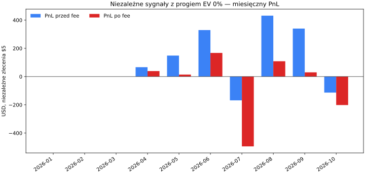
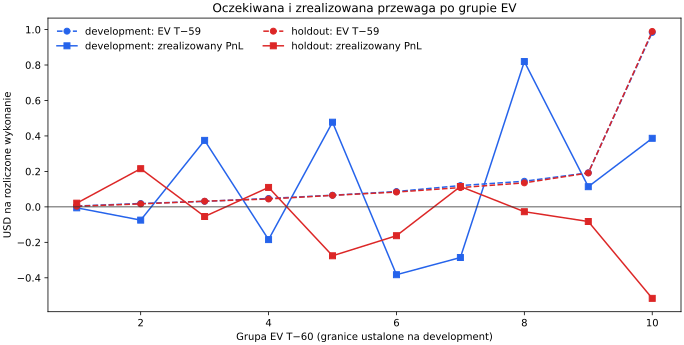
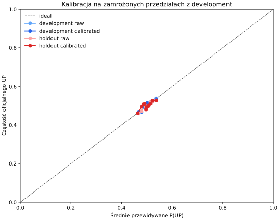
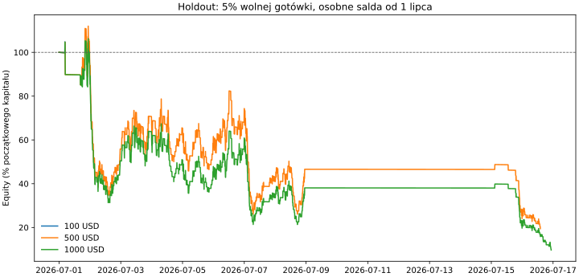

# Diagnostyka przewagi BTC 5m — 2026-10-12

> Historycznie oglądany holdout (2026-07-01–2026-10-06); raport jest diagnostyką, nie niezależnym testem potwierdzającym.
> Niezależne sygnały $5 nie są portfelem $100; ich łączny PnL nie jest wynikiem osiągalnym z takim depozytem.

> Korekta poprzedniego raportu: pierwotna wersja używała wycen T−60 dla niezależnych wykonań T−59. Ta korekta przelicza fille, PnL, przedziały bootstrap i wykresy z rzeczywistych snapshotów T−59.

## Werdykt

Na całym holdoucie model ma słabe rozróżnianie (AUC 52.20%); log loss 0.69247 wobec 0.69315 i Brier 0.24966 wobec 0.25000 dla baseline’u 0.5, slope/intercept 0.790/-0.001. Sygnały zero-hurdle: Development: $544.76 przed fee, $220.74 po fee; holdout: $489.81 / $-557.30; łącznie: $1,034.57 / $-336.57 na odpowiednich rozliczonych fillach. W portfelu 5% wolnej gotówki zawartość minimum ogranicza aktywność: fill’e dla kapitałów $100/$500/$1000 = 2/582/603, a pominięcia przez minimum = 23105/20869/20773. Szczegóły miesięczne i rozkład wykonania pokazują, czy poza minimum brakowało również dodatnich sygnałów.

## Zamrożony zakres i dane

Development obejmuje predykcje od 2026-01-01T00:00:00+00:00 do cutoffu 2026-07-01T00:00:00+00:00; holdout obejmuje starty rynków od tej daty do 2026-10-07T00:00:00+00:00 (exclusive). Progi EV zachowano z konfiguracji eksperymentu: 0%, 0.25%, 0.5%, 1%, 2%. Aktywny challenger wybrany na development: `free_cash_5pct_ev_0.0000pct` przy hurdle 0%; oficjalny selektor no-trade pozostał bez zmian (`no_trade`).

Użyto 80,352 gotowych predykcji, 79,680 potwierdzonych rynków, 79,666 oficjalnych wyników oraz 50,184/50,184 snapshotów T−60/T−59. Księgi do ekonomiki zaczynają się 2026-04-15T17:05:00+00:00; brak wcześniejszych snapshotów jest raportowany jako przyczyna, nie jako wyceniony sygnał.

Nie trenowano modelu, nie robiono refitu ani replayu archiwum księgi. Nie zmieniono konfiguracji live. Opłaty, minimum USDC, FAK i częściowe wypełnienia pochodzą z zaakceptowanego fee-correction.

## Niezależne zlecenia $5

Każda decyzja wybiera stronę wyłącznie z wyceny T−60. Wykonanie testuje tę samą stronę na T−59. Zlecenia nie współdzielą salda. Wyniki PnL liczą wyłącznie wykonania z oficjalnym rozliczeniem; fill bez etykiety pozostaje policzony jako fill, ale nie dostaje PnL równemu zero.

### Łącznie

| Okres | EV min. | Rynki | Predykcje | Decyzje wycenialne | Sygnały | Fille | Rozliczone fille | Obrót na wspólnej próbie | Fee eq. | PnL brutto | PnL netto | Netto/obrót | Wygrane–przegrane | Śr. cena | Pełna księga / proxy / partial |
|---|---:|---:|---:|---:|---:|---:|---:|---:|---:|---:|---:|---:|---:|---:|---:|
| development | 0% | 47,489 | 52,128 | 9,329 | 1,818 | 1,798 | 1,798 | $8,990.00 | $322.03 | $544.76 | $220.74 | 2.46% | 934–864 | $0.487 | 1,798 / 0 / 0 |
| development | 0.25% | 47,489 | 52,128 | 9,329 | 1,636 | 1,618 | 1,618 | $8,090.00 | $290.37 | $513.57 | $221.74 | 2.74% | 841–777 | $0.486 | 1,618 / 0 / 0 |
| development | 0.5% | 47,489 | 52,128 | 9,329 | 1,459 | 1,443 | 1,443 | $7,215.00 | $259.65 | $489.91 | $228.96 | 3.17% | 751–692 | $0.484 | 1,443 / 0 / 0 |
| development | 1% | 47,489 | 52,128 | 9,329 | 1,146 | 1,133 | 1,133 | $5,665.00 | $205.13 | $435.95 | $230.39 | 4.07% | 590–543 | $0.480 | 1,133 / 0 / 0 |
| development | 2% | 47,489 | 52,128 | 9,329 | 716 | 703 | 703 | $3,515.00 | $129.40 | $299.00 | $168.62 | 4.80% | 362–341 | $0.469 | 703 / 0 / 0 |
| holdout | 0% | 28,222 | 28,224 | 23,113 | 6,248 | 5,871 | 5,871 | $29,355.00 | $1,047.12 | $489.81 | $-557.30 | -1.90% | 2,933–2,938 | $0.486 | 5,871 / 0 / 0 |
| holdout | 0.25% | 28,222 | 28,224 | 23,113 | 5,705 | 5,358 | 5,358 | $26,790.00 | $958.31 | $379.99 | $-578.32 | -2.16% | 2,663–2,695 | $0.484 | 5,358 / 0 / 0 |
| holdout | 0.5% | 28,222 | 28,224 | 23,113 | 5,176 | 4,862 | 4,862 | $24,310.00 | $872.20 | $185.37 | $-686.83 | -2.83% | 2,394–2,468 | $0.482 | 4,862 / 0 / 0 |
| holdout | 1% | 28,222 | 28,224 | 23,113 | 4,272 | 4,018 | 4,018 | $20,090.00 | $725.31 | $-6.86 | $-732.16 | -3.64% | 1,951–2,067 | $0.478 | 4,018 / 0 / 0 |
| holdout | 2% | 28,222 | 28,224 | 23,113 | 2,872 | 2,707 | 2,707 | $13,535.00 | $497.51 | $48.25 | $-449.26 | -3.32% | 1,297–1,410 | $0.467 | 2,707 / 0 / 0 |
| combined | 0% | 75,711 | 80,352 | 32,442 | 8,066 | 7,669 | 7,669 | $38,345.00 | $1,369.15 | $1,034.57 | $-336.57 | -0.88% | 3,867–3,802 | $0.486 | 7,669 / 0 / 0 |
| combined | 0.25% | 75,711 | 80,352 | 32,442 | 7,341 | 6,976 | 6,976 | $34,880.00 | $1,248.68 | $893.56 | $-356.59 | -1.02% | 3,504–3,472 | $0.484 | 6,976 / 0 / 0 |
| combined | 0.5% | 75,711 | 80,352 | 32,442 | 6,635 | 6,305 | 6,305 | $31,525.00 | $1,131.86 | $675.28 | $-457.87 | -1.45% | 3,145–3,160 | $0.482 | 6,305 / 0 / 0 |
| combined | 1% | 75,711 | 80,352 | 32,442 | 5,418 | 5,151 | 5,151 | $25,755.00 | $930.44 | $429.09 | $-501.77 | -1.95% | 2,541–2,610 | $0.478 | 5,151 / 0 / 0 |
| combined | 2% | 75,711 | 80,352 | 32,442 | 3,588 | 3,410 | 3,410 | $17,050.00 | $626.91 | $347.25 | $-280.64 | -1.65% | 1,659–1,751 | $0.467 | 3,410 / 0 / 0 |

PnL brutto i netto są liczone na tych samych rozliczonych fillach. Fee eq. pokazuje estymowaną opłatę w USD przy wejściu. Dla V1 fee pobierane w udziałach zmienia zrealizowany payout tylko przy wygranej; dlatego osobny `realized fee effect` uzgadnia brutto z netto, a sama kwota fee eq. nie jest mechanicznie odejmowana od każdej przegranej.

### Miesięcznie — wszystkie progi EV

| Miesiąc UTC | EV min. | Rynki | Predykcje | Decyzje wycenialne | Sygnały | Fille | Rozliczone | Obrót | Fee eq. | PnL brutto | PnL netto | Netto/obrót |
|---|---:|---:|---:|---:|---:|---:|---:|---:|---:|---:|---:|---:|
| 2026-01 | 0% | 7,475 | 8,928 | 0 | 0 | 0 | 0 | $0.00 | $0.00 | $0.00 | $0.00 | n/a |
| 2026-01 | 0.25% | 7,475 | 8,928 | 0 | 0 | 0 | 0 | $0.00 | $0.00 | $0.00 | $0.00 | n/a |
| 2026-01 | 0.5% | 7,475 | 8,928 | 0 | 0 | 0 | 0 | $0.00 | $0.00 | $0.00 | $0.00 | n/a |
| 2026-01 | 1% | 7,475 | 8,928 | 0 | 0 | 0 | 0 | $0.00 | $0.00 | $0.00 | $0.00 | n/a |
| 2026-01 | 2% | 7,475 | 8,928 | 0 | 0 | 0 | 0 | $0.00 | $0.00 | $0.00 | $0.00 | n/a |
| 2026-02 | 0% | 4,889 | 8,064 | 0 | 0 | 0 | 0 | $0.00 | $0.00 | $0.00 | $0.00 | n/a |
| 2026-02 | 0.25% | 4,889 | 8,064 | 0 | 0 | 0 | 0 | $0.00 | $0.00 | $0.00 | $0.00 | n/a |
| 2026-02 | 0.5% | 4,889 | 8,064 | 0 | 0 | 0 | 0 | $0.00 | $0.00 | $0.00 | $0.00 | n/a |
| 2026-02 | 1% | 4,889 | 8,064 | 0 | 0 | 0 | 0 | $0.00 | $0.00 | $0.00 | $0.00 | n/a |
| 2026-02 | 2% | 4,889 | 8,064 | 0 | 0 | 0 | 0 | $0.00 | $0.00 | $0.00 | $0.00 | n/a |
| 2026-03 | 0% | 8,928 | 8,928 | 0 | 0 | 0 | 0 | $0.00 | $0.00 | $0.00 | $0.00 | n/a |
| 2026-03 | 0.25% | 8,928 | 8,928 | 0 | 0 | 0 | 0 | $0.00 | $0.00 | $0.00 | $0.00 | n/a |
| 2026-03 | 0.5% | 8,928 | 8,928 | 0 | 0 | 0 | 0 | $0.00 | $0.00 | $0.00 | $0.00 | n/a |
| 2026-03 | 1% | 8,928 | 8,928 | 0 | 0 | 0 | 0 | $0.00 | $0.00 | $0.00 | $0.00 | n/a |
| 2026-03 | 2% | 8,928 | 8,928 | 0 | 0 | 0 | 0 | $0.00 | $0.00 | $0.00 | $0.00 | n/a |
| 2026-04 | 0% | 8,636 | 8,640 | 1,667 | 145 | 142 | 142 | $710.00 | $25.64 | $66.55 | $38.91 | 5.48% |
| 2026-04 | 0.25% | 8,636 | 8,640 | 1,667 | 130 | 127 | 127 | $635.00 | $22.96 | $51.94 | $27.52 | 4.33% |
| 2026-04 | 0.5% | 8,636 | 8,640 | 1,667 | 109 | 107 | 107 | $535.00 | $19.35 | $31.93 | $11.29 | 2.11% |
| 2026-04 | 1% | 8,636 | 8,640 | 1,667 | 66 | 64 | 64 | $320.00 | $11.63 | $7.85 | $-4.21 | -1.32% |
| 2026-04 | 2% | 8,636 | 8,640 | 1,667 | 35 | 33 | 33 | $165.00 | $6.04 | $32.83 | $25.81 | 15.64% |
| 2026-05 | 0% | 8,927 | 8,928 | 4,518 | 748 | 738 | 738 | $3,690.00 | $134.54 | $148.79 | $14.25 | 0.39% |
| 2026-05 | 0.25% | 8,927 | 8,928 | 4,518 | 661 | 652 | 652 | $3,260.00 | $119.34 | $116.17 | $-3.16 | -0.10% |
| 2026-05 | 0.5% | 8,927 | 8,928 | 4,518 | 589 | 581 | 581 | $2,905.00 | $106.82 | $129.45 | $22.63 | 0.78% |
| 2026-05 | 1% | 8,927 | 8,928 | 4,518 | 463 | 456 | 456 | $2,280.00 | $84.70 | $142.31 | $57.61 | 2.53% |
| 2026-05 | 2% | 8,927 | 8,928 | 4,518 | 300 | 293 | 293 | $1,465.00 | $55.82 | $132.45 | $76.63 | 5.23% |
| 2026-06 | 0% | 8,634 | 8,640 | 3,144 | 925 | 918 | 918 | $4,590.00 | $161.85 | $329.43 | $167.58 | 3.65% |
| 2026-06 | 0.25% | 8,634 | 8,640 | 3,144 | 845 | 839 | 839 | $4,195.00 | $148.08 | $345.46 | $197.38 | 4.71% |
| 2026-06 | 0.5% | 8,634 | 8,640 | 3,144 | 761 | 755 | 755 | $3,775.00 | $133.48 | $328.53 | $195.04 | 5.17% |
| 2026-06 | 1% | 8,634 | 8,640 | 3,144 | 617 | 613 | 613 | $3,065.00 | $108.80 | $285.79 | $176.99 | 5.77% |
| 2026-06 | 2% | 8,634 | 8,640 | 3,144 | 381 | 377 | 377 | $1,885.00 | $67.53 | $133.71 | $66.18 | 3.51% |
| 2026-07 | 0% | 8,927 | 8,928 | 6,453 | 1,861 | 1,824 | 1,824 | $9,120.00 | $326.11 | $-168.29 | $-494.40 | -5.42% |
| 2026-07 | 0.25% | 8,927 | 8,928 | 6,453 | 1,697 | 1,663 | 1,663 | $8,315.00 | $298.11 | $-200.55 | $-498.66 | -6.00% |
| 2026-07 | 0.5% | 8,927 | 8,928 | 6,453 | 1,541 | 1,511 | 1,511 | $7,555.00 | $271.69 | $-325.86 | $-597.54 | -7.91% |
| 2026-07 | 1% | 8,927 | 8,928 | 6,453 | 1,287 | 1,264 | 1,264 | $6,320.00 | $228.61 | $-437.06 | $-665.67 | -10.53% |
| 2026-07 | 2% | 8,927 | 8,928 | 6,453 | 885 | 866 | 866 | $4,330.00 | $159.29 | $-332.31 | $-491.59 | -11.35% |
| 2026-08 | 0% | 8,928 | 8,928 | 6,370 | 1,894 | 1,788 | 1,788 | $8,940.00 | $322.86 | $431.55 | $108.68 | 1.22% |
| 2026-08 | 0.25% | 8,928 | 8,928 | 6,370 | 1,745 | 1,647 | 1,647 | $8,235.00 | $298.41 | $254.71 | $-43.70 | -0.53% |
| 2026-08 | 0.5% | 8,928 | 8,928 | 6,370 | 1,592 | 1,500 | 1,500 | $7,500.00 | $272.90 | $301.63 | $28.72 | 0.38% |
| 2026-08 | 1% | 8,928 | 8,928 | 6,370 | 1,345 | 1,266 | 1,266 | $6,330.00 | $232.19 | $329.87 | $97.69 | 1.54% |
| 2026-08 | 2% | 8,928 | 8,928 | 6,370 | 923 | 865 | 865 | $4,325.00 | $162.52 | $268.82 | $106.31 | 2.46% |
| 2026-09 | 0% | 8,639 | 8,640 | 8,564 | 1,988 | 1,755 | 1,755 | $8,775.00 | $309.94 | $339.99 | $30.06 | 0.34% |
| 2026-09 | 0.25% | 8,639 | 8,640 | 8,564 | 1,801 | 1,587 | 1,587 | $7,935.00 | $281.00 | $391.53 | $110.53 | 1.39% |
| 2026-09 | 0.5% | 8,639 | 8,640 | 8,564 | 1,624 | 1,433 | 1,433 | $7,165.00 | $254.27 | $287.93 | $33.66 | 0.47% |
| 2026-09 | 1% | 8,639 | 8,640 | 8,564 | 1,290 | 1,139 | 1,139 | $5,695.00 | $203.07 | $229.99 | $26.92 | 0.47% |
| 2026-09 | 2% | 8,639 | 8,640 | 8,564 | 840 | 753 | 753 | $3,765.00 | $136.11 | $216.46 | $80.35 | 2.13% |
| 2026-10 | 0% | 1,728 | 1,728 | 1,726 | 505 | 504 | 504 | $2,520.00 | $88.20 | $-113.44 | $-201.64 | -8.00% |
| 2026-10 | 0.25% | 1,728 | 1,728 | 1,726 | 462 | 461 | 461 | $2,305.00 | $80.79 | $-65.70 | $-146.49 | -6.36% |
| 2026-10 | 0.5% | 1,728 | 1,728 | 1,726 | 419 | 418 | 418 | $2,090.00 | $73.33 | $-78.33 | $-151.67 | -7.26% |
| 2026-10 | 1% | 1,728 | 1,728 | 1,726 | 350 | 349 | 349 | $1,745.00 | $61.44 | $-129.66 | $-191.10 | -10.95% |
| 2026-10 | 2% | 1,728 | 1,728 | 1,726 | 224 | 223 | 223 | $1,115.00 | $39.60 | $-104.73 | $-144.32 | -12.94% |

### Oczekiwana a zrealizowana przewaga (te same fill’e)

| Okres | EV min. | EV netto T−60 | EV netto T−59 | Zmiana brutto T−60→T−59 | Błąd payoutu (brutto) | Fee effect zrealizowany | PnL netto | Bootstrap mean PnL/obrót [95% CI] | Bootstrap mean EV−PnL/fill [95% CI] | Uzgodnienie residual |
|---|---:|---:|---:|---:|---:|---:|---:|---:|---:|---:|
| development | 0% | $299.64 | $301.71 | $2.10 | $-80.28 | −$324.02 | $220.74 | 2.22% [-1.60%; 5.69%] | $0.059 [$-0.137; $0.275] | $-0.000000 |
| development | 0.25% | $298.47 | $300.88 | $2.44 | $-78.88 | −$291.84 | $221.74 | 2.40% [-1.96%; 6.10%] | $0.068 [$-0.153; $0.324] | $-0.000000 |
| development | 0.5% | $295.19 | $297.60 | $2.44 | $-68.42 | −$260.95 | $228.96 | 2.80% [-1.63%; 6.59%] | $0.069 [$-0.165; $0.302] | $-0.000000 |
| development | 1% | $283.83 | $286.34 | $2.53 | $-56.28 | −$205.56 | $230.39 | 3.86% [-0.52%; 7.89%] | $0.064 [$-0.189; $0.340] | $-0.000000 |
| development | 2% | $251.69 | $254.63 | $2.99 | $-85.53 | −$130.38 | $168.62 | 4.93% [0.07%; 9.44%] | $0.121 [$-0.160; $0.395] | $0.000000 |
| holdout | 0% | $1,312.84 | $1,282.12 | $-31.73 | $-1,839.43 | −$1,047.12 | $-557.30 | -1.79% [-4.67%; 1.19%] | $0.309 [$0.141; $0.476] | $0.000000 |
| holdout | 0.25% | $1,309.62 | $1,280.36 | $-30.22 | $-1,858.68 | −$958.31 | $-578.32 | -2.13% [-4.87%; 0.85%] | $0.347 [$0.166; $0.518] | $0.000000 |
| holdout | 0.5% | $1,300.37 | $1,272.16 | $-29.12 | $-1,959.00 | −$872.20 | $-686.83 | -2.72% [-5.33%; 0.40%] | $0.399 [$0.214; $0.577] | $0.000000 |
| holdout | 1% | $1,269.08 | $1,242.33 | $-27.61 | $-1,974.49 | −$725.31 | $-732.16 | -3.54% [-6.71%; -0.12%] | $0.487 [$0.274; $0.680] | $0.000000 |
| holdout | 2% | $1,172.67 | $1,149.97 | $-23.41 | $-1,599.24 | −$497.51 | $-449.26 | -3.14% [-7.45%; 1.27%] | $0.583 [$0.328; $0.846] | $0.000000 |
| combined | 0% | $1,612.48 | $1,583.84 | $-29.64 | $-1,919.70 | −$1,371.14 | $-336.57 | -0.91% [-3.25%; 1.50%] | $0.254 [$0.110; $0.402] | $0.000000 |
| combined | 0.25% | $1,608.09 | $1,581.24 | $-27.78 | $-1,937.56 | −$1,250.15 | $-356.59 | -1.09% [-3.55%; 1.44%] | $0.283 [$0.130; $0.442] | $-0.000000 |
| combined | 0.5% | $1,595.56 | $1,569.76 | $-26.68 | $-2,027.41 | −$1,133.15 | $-457.87 | -1.46% [-3.86%; 1.22%] | $0.324 [$0.159; $0.491] | $0.000000 |
| combined | 1% | $1,552.92 | $1,528.67 | $-25.08 | $-2,030.77 | −$930.86 | $-501.77 | -1.96% [-4.89%; 1.10%] | $0.398 [$0.209; $0.588] | $0.000000 |
| combined | 2% | $1,424.36 | $1,404.61 | $-20.41 | $-1,684.76 | −$627.89 | $-280.64 | -1.61% [-5.30%; 2.27%] | $0.496 [$0.280; $0.721] | $-0.000000 |

Uzgodnienie netto: `EV brutto T−60 + zmiana oczekiwanej wartości brutto przy wycenie T−59 + (wynik brutto − oczekiwany payout T−59) − zrealizowany fee effect = PnL netto`. EV netto T−60/T−59 pokazano osobno. Dla przedziałów użyto istniejącego `utils.polymarket_diagnostics.block_uncertainty`: ruchome bloki 3 dni UTC, 1 000 replikacji, seed 20261002, wspólne losowania bloków i dni bez transakcji. ROI jest warunkowe na wykonanych sygnałach; bootstrap nie symuluje salda ani ponownej selekcji.

### Powody braku wykonania — zero hurdle

| Okres | Powód | Liczba rynków |
|---|---|---:|
| development | `ambiguous_equal_source_timestamp_order` | 11 |
| development | `archive_gap_after_book_initialization` | 8 |
| development | `archive_hour_missing_at_entry` | 36 |
| development | `crossed_token_book_at_entry` | 1 |
| development | `exchange_maintenance_pause` | 6 |
| development | `missing_t60_decision_snapshot` | 25,527 |
| development | `native_ask_bbo_reconciliation_mismatch` | 8 |
| development | `no_gamma_market_record` | 4,639 |
| development | `no_native_book_snapshot` | 5,365 |
| development | `no_positive_t60_net_ev` | 7,511 |
| development | `no_priceable_native_ask_side` | 7,218 |
| holdout | `ambiguous_equal_source_timestamp_order` | 372 |
| holdout | `future_source_timestamp_at_entry` | 5 |
| holdout | `native_ask_bbo_reconciliation_mismatch` | 4 |
| holdout | `no_gamma_market_record` | 2 |
| holdout | `no_native_book_snapshot` | 3,017 |
| holdout | `no_positive_t60_net_ev` | 16,865 |
| holdout | `no_priceable_native_ask_side` | 2,088 |
| combined | `ambiguous_equal_source_timestamp_order` | 383 |
| combined | `archive_gap_after_book_initialization` | 8 |
| combined | `archive_hour_missing_at_entry` | 36 |
| combined | `crossed_token_book_at_entry` | 1 |
| combined | `exchange_maintenance_pause` | 6 |
| combined | `future_source_timestamp_at_entry` | 5 |
| combined | `missing_t60_decision_snapshot` | 25,527 |
| combined | `native_ask_bbo_reconciliation_mismatch` | 12 |
| combined | `no_gamma_market_record` | 4,641 |
| combined | `no_native_book_snapshot` | 8,382 |
| combined | `no_positive_t60_net_ev` | 24,376 |
| combined | `no_priceable_native_ask_side` | 9,306 |

## Jakość predykcji na dostępnych rynkach

Kalibrator jest zamrożony. Baseline częstości UP jest liczony wyłącznie na development, osobno dla etykiety i zakresu próby. Wspólna próba ceny BTC i oficjalnego rozliczenia pozwala rozdzielić jakość targetu treningowego od rozliczeń Polymarket.

| Okres | Próba | Target | Prognoza | N | UP | Log loss | Brier | AUC | Slope / intercept | ECE (biny dev) | LL baseline 0.5 / dev-rate | Brier baseline 0.5 / dev-rate |
|---|---|---|---|---:|---:|---:|---:|---:|---:|---:|---:|---:|
| development | all_available | official_polymarket | raw | 47,483 | 50.24% | 0.69226 | 0.24956 | 0.5238 | 1.071 / 0.004 | 0.0034 | 0.69315 / 0.69314 | 0.25000 / 0.24999 |
| development | all_available | official_polymarket | calibrated | 47,483 | 50.24% | 0.69231 | 0.24958 | 0.5233 | 1.023 / 0.008 | 0.0055 | 0.69315 / 0.69314 | 0.25000 / 0.24999 |
| development | all_available | price_training_target | raw | 52,128 | 50.05% | 0.69212 | 0.24949 | 0.5257 | 1.157 / -0.005 | 0.0041 | 0.69315 / 0.69315 | 0.25000 / 0.25000 |
| development | all_available | price_training_target | calibrated | 52,128 | 50.05% | 0.69216 | 0.24951 | 0.5253 | 1.121 / 0.000 | 0.0063 | 0.69315 / 0.69315 | 0.25000 / 0.25000 |
| development | common_official_and_price_target | official_polymarket | raw | 47,483 | 50.24% | 0.69226 | 0.24956 | 0.5238 | 1.071 / 0.004 | 0.0034 | 0.69315 / 0.69314 | 0.25000 / 0.24999 |
| development | common_official_and_price_target | official_polymarket | calibrated | 47,483 | 50.24% | 0.69231 | 0.24958 | 0.5233 | 1.023 / 0.008 | 0.0055 | 0.69315 / 0.69314 | 0.25000 / 0.24999 |
| development | common_official_and_price_target | price_training_target | raw | 47,483 | 50.19% | 0.69209 | 0.24947 | 0.5260 | 1.183 / 0.001 | 0.0046 | 0.69315 / 0.69314 | 0.25000 / 0.25000 |
| development | common_official_and_price_target | price_training_target | calibrated | 47,483 | 50.19% | 0.69216 | 0.24951 | 0.5254 | 1.119 / 0.006 | 0.0067 | 0.69315 / 0.69314 | 0.25000 / 0.25000 |
| holdout | all_available | official_polymarket | raw | 28,221 | 49.97% | 0.69242 | 0.24964 | 0.5220 | 0.914 / -0.005 | 0.0079 | 0.69315 / 0.69316 | 0.25000 / 0.25001 |
| holdout | all_available | official_polymarket | calibrated | 28,221 | 49.97% | 0.69247 | 0.24966 | 0.5220 | 0.790 / -0.001 | 0.0094 | 0.69315 / 0.69316 | 0.25000 / 0.25001 |
| holdout | all_available | price_training_target | raw | 28,224 | 49.85% | 0.69248 | 0.24966 | 0.5211 | 0.887 / -0.010 | 0.0077 | 0.69315 / 0.69315 | 0.25000 / 0.25000 |
| holdout | all_available | price_training_target | calibrated | 28,224 | 49.85% | 0.69252 | 0.24969 | 0.5211 | 0.766 / -0.006 | 0.0080 | 0.69315 / 0.69315 | 0.25000 / 0.25000 |
| holdout | common_official_and_price_target | official_polymarket | raw | 28,221 | 49.97% | 0.69242 | 0.24964 | 0.5220 | 0.914 / -0.005 | 0.0079 | 0.69315 / 0.69316 | 0.25000 / 0.25001 |
| holdout | common_official_and_price_target | official_polymarket | calibrated | 28,221 | 49.97% | 0.69247 | 0.24966 | 0.5220 | 0.790 / -0.001 | 0.0094 | 0.69315 / 0.69316 | 0.25000 / 0.25001 |
| holdout | common_official_and_price_target | price_training_target | raw | 28,221 | 49.85% | 0.69247 | 0.24966 | 0.5211 | 0.888 / -0.010 | 0.0076 | 0.69315 / 0.69317 | 0.25000 / 0.25001 |
| holdout | common_official_and_price_target | price_training_target | calibrated | 28,221 | 49.85% | 0.69252 | 0.24969 | 0.5211 | 0.767 / -0.006 | 0.0079 | 0.69315 / 0.69317 | 0.25000 / 0.25001 |
| combined | all_available | official_polymarket | raw | 75,704 | 50.14% | 0.69232 | 0.24959 | 0.5231 | 1.007 / 0.001 | 0.0041 | 0.69315 / 0.69315 | 0.25000 / 0.25000 |
| combined | all_available | official_polymarket | calibrated | 75,704 | 50.14% | 0.69237 | 0.24961 | 0.5227 | 0.914 / 0.004 | 0.0040 | 0.69315 / 0.69315 | 0.25000 / 0.25000 |
| combined | all_available | price_training_target | raw | 80,352 | 49.98% | 0.69224 | 0.24955 | 0.5240 | 1.056 / -0.006 | 0.0046 | 0.69315 / 0.69315 | 0.25000 / 0.25000 |
| combined | all_available | price_training_target | calibrated | 80,352 | 49.98% | 0.69229 | 0.24957 | 0.5236 | 0.964 / -0.002 | 0.0042 | 0.69315 / 0.69315 | 0.25000 / 0.25000 |
| combined | common_official_and_price_target | official_polymarket | raw | 75,704 | 50.14% | 0.69232 | 0.24959 | 0.5231 | 1.007 / 0.001 | 0.0041 | 0.69315 / 0.69315 | 0.25000 / 0.25000 |
| combined | common_official_and_price_target | official_polymarket | calibrated | 75,704 | 50.14% | 0.69237 | 0.24961 | 0.5227 | 0.914 / 0.004 | 0.0040 | 0.69315 / 0.69315 | 0.25000 / 0.25000 |
| combined | common_official_and_price_target | price_training_target | raw | 75,704 | 50.07% | 0.69223 | 0.24954 | 0.5241 | 1.063 / -0.003 | 0.0041 | 0.69315 / 0.69315 | 0.25000 / 0.25000 |
| combined | common_official_and_price_target | price_training_target | calibrated | 75,704 | 50.07% | 0.69229 | 0.24957 | 0.5236 | 0.955 / 0.002 | 0.0046 | 0.69315 / 0.69315 | 0.25000 / 0.25000 |

Przedziały kalibracji są kwantylami skalibrowanego P(UP) z development (granice wraz z liczebnościami zapisano w `calibration_bins.csv`); na holdoucie zastosowano te same granice. Surowe i skalibrowane szeregi są pokazane równolegle.

## Kapitał i minimum zlecenia

Każdy holdout portfel startuje osobno 1 lipca. Użyto 5% wolnej gotówki, challengera 0% EV z development, rzeczywistej głębokości dostępnej przy większym zleceniu, fee i częściowego FAK. Oficjalny selektor pozostaje `no_trade`; te portfele są diagnostyczne.

| Start | Kapitał końcowy | Zwrot | Max DD | Obrót | Fee eq. | Transakcje | Odrzucenia minimum | Brak wolnej gotówki | Pierwsza → ostatnia transakcja | Pierwszy skip minimum | Minimum zatrzymało dalsze fill’e? |
|---:|---:|---:|---:|---:|---:|---:|---:|---:|---|---|---|
| $100 | $99.40 | -0.60% | 5.17% | $10.24 | $0.36 | 2 | 23,105 | 0 | 2026-07-01T04:30:00+00:00 → 2026-07-01T04:40:00+00:00 | 2026-07-01T04:34:01+00:00 | nie |
| $500 | $97.20 | -80.56% | 82.64% | $7,608.88 | $270.04 | 582 | 20,869 | 0 | 2026-07-01T04:30:00+00:00 → 2026-07-16T14:00:00+00:00 | 2026-07-16T14:04:01+00:00 | tak |
| $1,000 | $96.91 | -90.31% | 90.88% | $13,035.99 | $462.57 | 603 | 20,773 | 0 | 2026-07-01T04:30:00+00:00 → 2026-07-16T22:25:00+00:00 | 2026-07-16T22:29:01+00:00 | tak |

Miesięczna aktywność portfeli:

| Start | Miesiąc | Transakcje | Obrót | Fee | PnL equity |
|---:|---|---:|---:|---:|---:|
| $100 | 2026-06 | 0 | $0.00 | $0.00 | $0.00 |
| $100 | 2026-07 | 2 | $10.24 | $0.36 | $-0.60 |
| $100 | 2026-08 | 0 | $0.00 | $0.00 | $0.00 |
| $100 | 2026-09 | 0 | $0.00 | $0.00 | $0.00 |
| $100 | 2026-10 | 0 | $0.00 | $0.00 | $0.00 |
| $500 | 2026-06 | 0 | $0.00 | $0.00 | $0.00 |
| $500 | 2026-07 | 582 | $7,608.88 | $270.04 | $-402.80 |
| $500 | 2026-08 | 0 | $0.00 | $0.00 | $0.00 |
| $500 | 2026-09 | 0 | $0.00 | $0.00 | $0.00 |
| $500 | 2026-10 | 0 | $0.00 | $0.00 | $0.00 |
| $1,000 | 2026-06 | 0 | $0.00 | $0.00 | $0.00 |
| $1,000 | 2026-07 | 603 | $13,035.99 | $462.57 | $-903.09 |
| $1,000 | 2026-08 | 0 | $0.00 | $0.00 | $0.00 |
| $1,000 | 2026-09 | 0 | $0.00 | $0.00 | $0.00 |
| $1,000 | 2026-10 | 0 | $0.00 | $0.00 | $0.00 |

Minimum bazuje na bieżącym Gamma `orderMinSize` w USDC albo fallbacku $5 i nie jest archiwalnym odczytem historycznym. Zlecenia poniżej progu nie były podbijane; FAK może pozostawić częściowy fill po spełnieniu minimum przez kwotę żądaną.

## Wnioski do sześciu pytań

Korekta T−59 przy hurdle 0% na holdoucie: poprzednio 6,248 fille, EV−PnL $1,862.93; po przeliczeniu 5,871 filli, EV−PnL $1,839.43. Różnica PnL netto: $-61.88. Portfele 5% nie zmieniły się, ponieważ ich wykonania już używały snapshotów T−59.

1. Jakość modelu na holdoucie: słabe rozróżnianie (AUC 52.20%); log loss 0.69247 wobec 0.69315 i Brier 0.24966 wobec 0.25000 dla baseline’u 0.5, slope/intercept 0.790/-0.001; szczegółowe baseline’y development-only są w tabeli jakości.
2. Przewaga wybranych sygnałów po fee: Development: $544.76 przed fee, $220.74 po fee; holdout: $489.81 / $-557.30; łącznie: $1,034.57 / $-336.57 na odpowiednich rozliczonych fillach. Wszystkie progi holdout są ujemne po fee; żadnego nie wybrano na holdoucie.
3. Wpływ zmiany wyceny T−60→T−59 oraz błędu payoutu jest rozdzielony w tabeli uzgodnienia (zmiana EV brutto, payout residual, fee effect).
4. Kapitał/minimum: liczba filli 5% dla $100/$500/$1000 to 2/582/603; pominięcia minimum to 23105/20869/20773. Zestaw z niezależnymi sygnałami i powodami no-trade.
5. Zmienność miesięczna jest w tabeli i wykresie; ocena dotyczy sygnałów w historycznie oglądanym zbiorze.
6. Obecna aktywna strategia nie uzyskuje potwierdzenia przez ten historycznie znany holdout. Następny test powinien dotyczyć wyłącznie wykrytego mechanizmu wykonania/minimum albo kalibracji selekcji, używając nowego przyszłego okresu; holdouta nie wolno ponownie stroić.

Dalszy krok badawczy, jeśli wskazany, musi testować konkretny mechanizm rozpoznany powyżej. Obejrzanego holdoutu nie wolno używać do strojenia i nadal nazywać niezależnym testem.

## Proweniencja i kontrole

Manifest: `data/analysis/polymarket/BTC/preopen_research_20261012_signal_diagnostic_correction/signal_diagnostic_manifest.json`. Szczegółowy ledger: `data/analysis/polymarket/BTC/preopen_research_20261012_signal_diagnostic_correction/independent_signal_decisions.parquet`; miesięczne tabele i metryki: `data/analysis/polymarket/BTC/preopen_research_20261012_signal_diagnostic_correction`.

Hash OOF manifestu: `001dcd816a83ea5bda001595ddd6e57d977cee0624c2eff5a585e9b2498be88a`; hash model bundle: `4820e23493efb1743863b58b411352006a71ff7ce8c66068c17c8c88e65e4583`; hash predykcji holdout: `b8febf2da37695cae6727737abc9cd650c7a69052b97b6ac72d27254801426f6`; T−60: `38259fadf50c28e455f5d4523610cbac827886e35922076dbba5cb33bd55e0b1`; T−59: `abee0fdaf31eaf1455b4343e985bf9d5ee38a84dd8eb7e06adf1e08fc0c380d0`. Wszystkie źródła zweryfikowano ponownie po obliczeniu.

Kontrole: niezależne sygnały nie używają salda; 7,669 wypełnionych i rozliczonych zleceń uzgodniono brutto/netto; trzy portfele przeszły audyt rachunkowości, nie miały ujemnej gotówki i nie wykonały zlecenia poniżej minimum. Czas obliczeń: 69.9 s.
